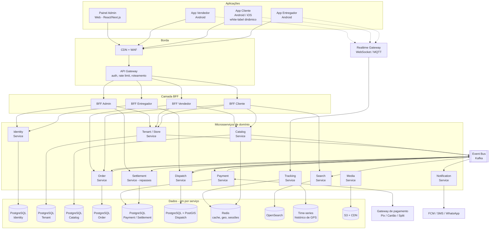
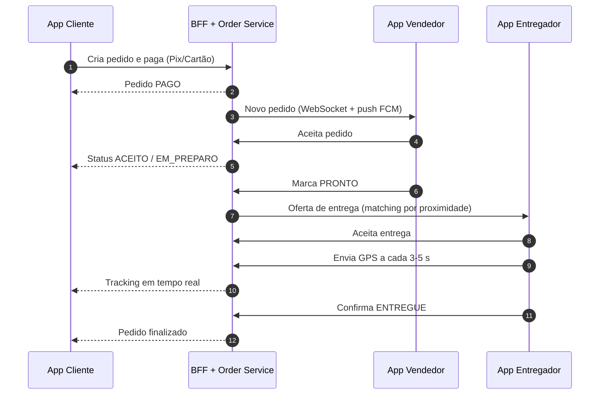
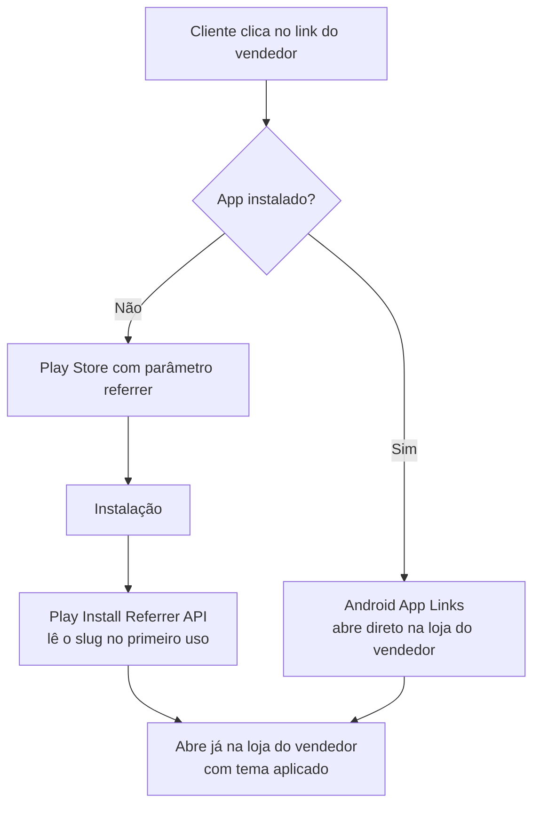
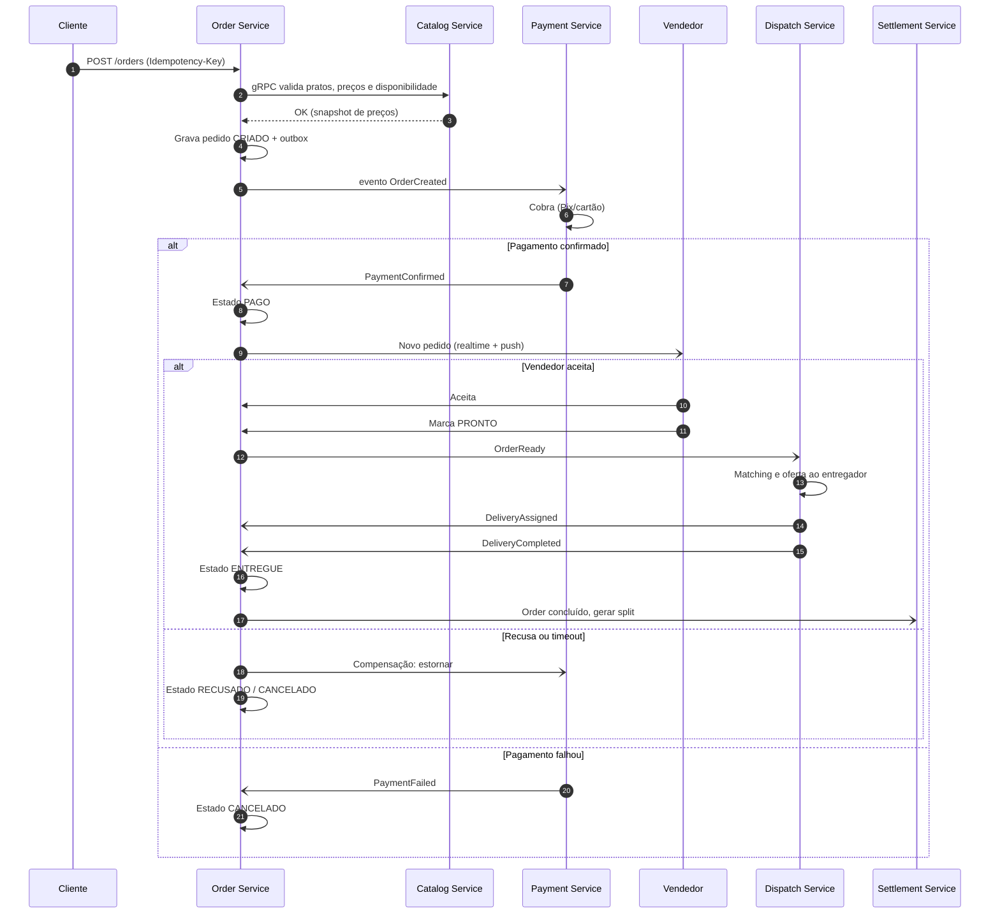
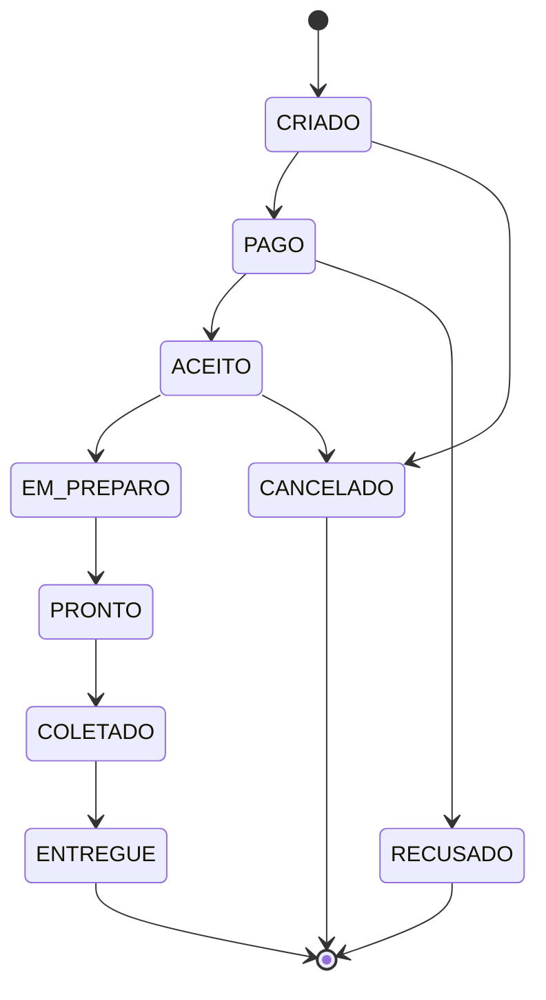
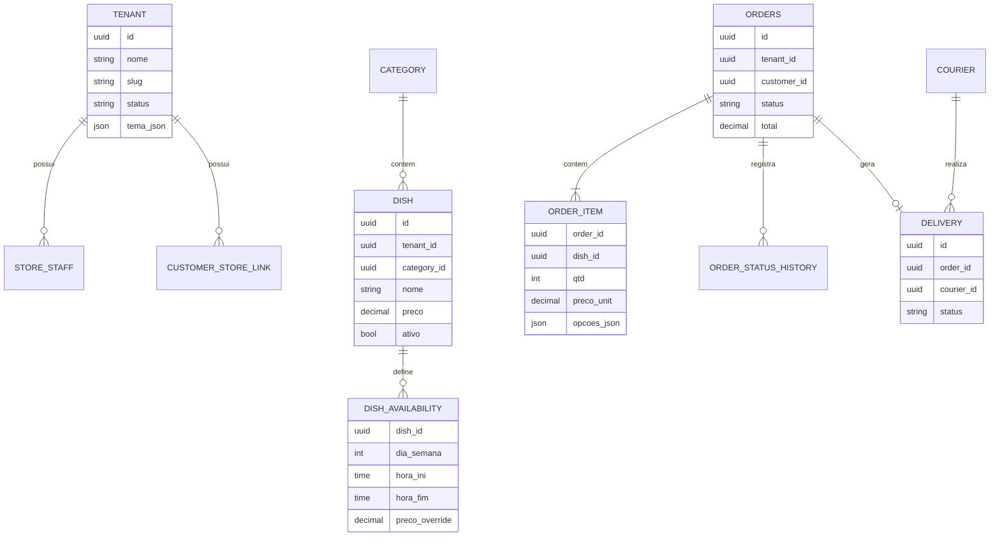

# Arquitetura: Marketplace de Delivery Multi-tenant (Microsserviços)

> Plataforma com **Painel Admin (web)**, **App Vendedor**, **App Cliente** e **App Entregador**, conectados a um conjunto de microsserviços atrás de um API Gateway.

**Versão:** 2.0 (microsserviços) · **Status:** Rascunho para validação

---

## Sumário

1. [Visão geral](#1-visão-geral)
2. [Como os 3 apps ficam "amarrados"](#2-como-os-3-apps-ficam-amarrados)
3. [Catálogo de microsserviços](#3-catálogo-de-microsserviços)
4. [Comunicação entre serviços](#4-comunicação-entre-serviços)
5. [Fluxo de pedido com Saga](#5-fluxo-de-pedido-com-saga)
6. [Dados e multi-tenancy](#6-dados-e-multi-tenancy)
7. [Performance, tempo real e escala](#7-performance-tempo-real-e-escala)
8. [Plataforma e infraestrutura](#8-plataforma-e-infraestrutura)
9. [Segurança e compliance](#9-segurança-e-compliance)
10. [Stack sugerida](#10-stack-sugerida)
11. [Roadmap](#11-roadmap)
12. [Riscos e pontos em aberto](#12-riscos-e-pontos-em-aberto)

---

## 1. Visão geral

### 1.1 Princípios

- **Cada serviço é dono do seu domínio e do seu banco** (database per service). Nenhum serviço lê o banco de outro.
- **Comunicação síncrona só quando o usuário espera a resposta**; o resto é assíncrono por eventos.
- **BFFs (Backend for Frontend)** por aplicação, para que cada app receba exatamente o que precisa.
- **Um único app de cliente na Play Store**, com identidade visual dinâmica por vendedor.
- **Consistência eventual** entre serviços, com Saga, Outbox e idempotência.
- **Automação e observabilidade como pré-requisito**, não como etapa posterior.

### 1.2 Canvas da arquitetura

### 1.3 Fluxo de um pedido (visão simplificada)

O detalhamento interno entre serviços está na [seção 5](#5-fluxo-de-pedido-com-saga).

---

## 2. Como os 3 apps ficam "amarrados"

### 2.1 Um app de cliente para todos os vendedores

Cada vendedor (tenant) possui:

- **Slug** único (ex.: `pizzariadojoao`).
- **Link próprio:** `https://seudominio.com/l/pizzariadojoao`.
- **Tema** (logo, cores, banner) servido pelo Tenant Service: `GET /tenants/{slug}/theme`, com cache agressivo em CDN e Redis.

### 2.2 Fluxo de entrada do cliente

| Item | Solução |
|---|---|
| App já instalado | Android App Links com `assetlinks.json` verificado |
| App não instalado | Play Store + `referrer=loja_<slug>` |
| Após instalar | **Play Install Referrer API** (deferred deep link) |
| Alternativa gerenciada | Branch.io (Firebase Dynamic Links foi descontinuado) |
| Tema por loja | Config dinâmica do Tenant Service, mesmo binário |
| Vínculo cliente-loja | Tabela `customer_store_link` no Tenant Service |

### 2.3 Amarração entre os apps

A amarração acontece por **identificadores compartilhados** (`tenant_id`, `order_id`, `delivery_id`) e **eventos de domínio**. Os apps nunca se comunicam entre si, apenas com seus BFFs.

---

## 3. Catálogo de microsserviços

### 3.1 Serviços de domínio

| Serviço | Responsabilidade | Dados que possui | Banco |
|---|---|---|---|
| **Identity** | Autenticação, papéis (admin, vendedor, cliente, entregador), JWT/refresh, OTP | `user`, `credential`, `session` | PostgreSQL |
| **Tenant/Store** | Dados cadastrais da loja, horários, taxa e raio de entrega, tema, slug, vínculo cliente-loja | `tenant`, `store_staff`, `customer_store_link` | PostgreSQL |
| **Catalog** | Categorias, pratos, adicionais, preços, regras de disponibilidade por dia/horário, estoque | `category`, `dish`, `dish_availability` | PostgreSQL + Redis |
| **Order** | Carrinho, checkout, máquina de estados, orquestração da Saga | `order`, `order_item`, `order_status_history` | PostgreSQL |
| **Payment** | Cobrança Pix/cartão, tokenização, estorno, webhooks | `payment`, `refund` | PostgreSQL |
| **Settlement** | Split, comissões, repasses a vendedores e entregadores | `ledger`, `payout` | PostgreSQL |
| **Dispatch** | Matching de entregador, ofertas, status da entrega, comprovação | `delivery`, `courier`, `courier_offer` | PostgreSQL + PostGIS |
| **Tracking** | Ingestão de GPS, posição atual, ETA | posição atual (Redis), histórico (time-series) | Redis + time-series |
| **Notification** | Push (FCM), SMS, e-mail, WhatsApp, templates, preferências | `template`, `notification_log` | PostgreSQL |
| **Search** | Busca de lojas e pratos (índice derivado de eventos) | índice | OpenSearch |
| **Media** | Upload por URL pré-assinada, redimensionamento, CDN | metadados | S3 + PostgreSQL |

### 3.2 Serviços de borda e plataforma

| Componente | Função |
|---|---|
| **API Gateway** | Autenticação do token, rate limit, roteamento, versionamento |
| **BFF Admin / Vendedor / Cliente / Entregador** | Agregam chamadas aos serviços e adaptam payloads a cada app |
| **Realtime Gateway** | Conexões WebSocket/MQTT; assina eventos e repassa a cada ator |
| **Event Bus (Kafka)** | Backbone de eventos de domínio |

### 3.3 Funcionalidades por aplicação

**Painel Admin**
- Cadastro, aprovação e suspensão de vendedores
- Gestão de entregadores
- Comissões, repasses e relatórios
- Monitoramento de pedidos e métricas

**App Vendedor**
- Dados cadastrais e personalização da loja
- Categorias, pratos, preços e adicionais
- Disponibilidade por dia/horário e preço por janela
- Gestão de pedidos em tempo real, abertura/fechamento da loja

**App Cliente**
- Entrada por deep link do vendedor
- Cardápio, carrinho, checkout e pagamento
- Tracking do pedido e histórico

**App Entregador**
- Cadastro e documentação
- Online/offline, ofertas de corrida
- Navegação, envio de GPS, confirmação de coleta e entrega
- Extrato de ganhos

---

## 4. Comunicação entre serviços

### 4.1 Regras

| Tipo | Quando usar | Tecnologia |
|---|---|---|
| **Externa (apps → BFF)** | Chamadas dos apps | REST/JSON (ou GraphQL nos BFFs) |
| **Síncrona interna** | O chamador precisa da resposta agora (ex.: validar preço do prato no checkout) | gRPC, com timeout, retry com backoff e circuit breaker |
| **Assíncrona (eventos)** | Notificar mudanças de estado, desacoplar domínios | Kafka |
| **Tempo real** | Push ao vendedor, cliente e entregador | WebSocket/MQTT + FCM |

### 4.2 Eventos de domínio principais

| Evento | Produtor | Consumidores |
|---|---|---|
| `OrderCreated` | Order | Payment |
| `PaymentConfirmed` / `PaymentFailed` | Payment | Order, Settlement |
| `OrderPaid` | Order | Notification (vendedor), Realtime |
| `OrderAccepted` / `OrderRejected` | Order | Notification (cliente), Payment (estorno se recusado) |
| `OrderReady` | Order | Dispatch |
| `DeliveryAssigned` | Dispatch | Order, Notification |
| `DeliveryCompleted` | Dispatch | Order, Settlement |
| `DishUpdated` / `StoreUpdated` | Catalog / Tenant | Search, cache |

### 4.3 Padrões obrigatórios

- **Outbox pattern:** o evento é gravado na mesma transação do banco do serviço e publicado por um relay/CDC (ex.: Debezium). Evita perder eventos.
- **Idempotência:** todo consumidor trata mensagens duplicadas (chave de idempotência por evento) e todo endpoint de checkout/pagamento aceita `Idempotency-Key`.
- **Contratos versionados:** esquemas de eventos em Schema Registry (Avro/Protobuf) e APIs com versionamento. Testes de contrato (Pact) no CI.
- **Resiliência:** timeouts, retries com backoff e jitter, circuit breaker, bulkheads, dead-letter queues.
- **Sem transações distribuídas (2PC):** consistência entre serviços via Saga.

---

## 5. Fluxo de pedido com Saga

O **Order Service** orquestra a Saga. Cada passo tem uma ação compensatória.

### 5.1 Máquina de estados do pedido

**Regras:** timeout se o vendedor não aceitar em X minutos (cancela e estorna); reoferta automática se nenhum entregador aceitar a corrida; todo estado grava histórico.

---

## 6. Dados e multi-tenancy

### 6.1 Database per service

| Serviço | Banco |
|---|---|
| Identity, Tenant, Catalog, Order, Payment/Settlement, Notification | PostgreSQL (instâncias ou schemas isolados com credenciais próprias) |
| Dispatch | PostgreSQL + PostGIS |
| Tracking | Redis (posição atual) + time-series (histórico) |
| Search | OpenSearch |
| Media | S3 |

Consultas que cruzam domínios (ex.: relatórios) usam **read models** alimentados por eventos (CQRS) ou um data warehouse, nunca joins entre bancos de serviços.

### 6.2 Multi-tenancy

- `tenant_id` em todas as tabelas de negócio de cada serviço.
- **Row-Level Security** no PostgreSQL de cada serviço.
- `tenant_id` viaja no **JWT** e é propagado por header interno (`X-Tenant-Id`) e nos eventos Kafka.
- Chaves de cache e tópicos/partições incluem o tenant quando relevante.
- Tenants muito grandes podem migrar para banco dedicado sem mudar a API.
- Testes automatizados de vazamento entre tenants no CI.

### 6.3 Modelo de dados por serviço

> Cada grupo de entidades pertence a um serviço diferente: Tenant/Store, Catalog, Order e Dispatch. As relações entre serviços são feitas **por ID**, sem foreign key entre bancos. O `ORDER_ITEM` guarda um **snapshot** de preço e nome do prato.

---

## 7. Performance, tempo real e escala

### 7.1 Leitura

- **Cardápio** é o caminho mais quente: cache em Redis por loja, invalidado por eventos `DishUpdated`, mais CDN para imagens e temas.
- Réplicas de leitura nos serviços de maior leitura (Catalog, Tenant).
- Busca de lojas/pratos no OpenSearch, indexada por eventos.

### 7.2 Tempo real

- **Vendedor:** WebSocket + push FCM de alta prioridade como fallback.
- **Entregador:** GPS a cada 3 a 5 segundos via MQTT/WebSocket para o **Tracking Service**, que atualiza o Redis (GEO) e publica ao cliente do pedido.
- **Nunca gravar cada ponto de GPS no Postgres em tempo real.** Bufferizar e persistir em lote no time-series DB.
- Realtime Gateway **stateless**, com estado de conexão no Redis, para escalar horizontalmente.

### 7.3 Escala por serviço

| Serviço | Gargalo esperado | Estratégia |
|---|---|---|
| Catalog / Search | Leitura | Cache, réplicas, CDN |
| Order | Pico nos horários de refeição | Autoscaling, particionamento por `tenant_id`, filas |
| Tracking / Realtime | Conexões e throughput | Escala horizontal, Redis, particionamento por região |
| Dispatch | Consultas geoespaciais | Redis GEO para candidatos, PostGIS para regra fina |
| Notification | Picos de envio | Filas, workers independentes, rate limit por provedor |
| Payment | Dependência externa | Circuit breaker, idempotência, reconciliação periódica |

### 7.4 Kafka

- Particionamento por `order_id` (ordem por pedido) ou `tenant_id`, conforme o tópico.
- Retenção configurada e DLQ por consumidor.
- Consumer groups por serviço para escala independente.

---

## 8. Plataforma e infraestrutura

| Área | Prática |
|---|---|
| **Orquestração** | Kubernetes (EKS/GKE) com HPA/KEDA (autoscaling por CPU e lag do Kafka) |
| **Service mesh** | Istio ou Linkerd para mTLS, retries e observabilidade (avaliar custo/benefício na fase inicial) |
| **IaC** | Terraform + GitOps (Argo CD / Flux) |
| **CI/CD** | Pipeline por serviço, deploy independente, canary/blue-green |
| **Repositório** | Monorepo (Nx/Turborepo/Bazel) ou polyrepo com templates padronizados |
| **Observabilidade** | Logs estruturados com `trace_id`, métricas (Prometheus/Grafana), tracing distribuído (OpenTelemetry + Tempo/Jaeger), Sentry nos apps |
| **Alertas** | SLOs por serviço (latência, erro, lag de fila), on-call e runbooks |
| **Ambientes** | dev, staging, prod; ambientes efêmeros por PR quando possível |
| **Config e segredos** | Vault / Secrets Manager, feature flags |
| **Resiliência** | Multi-AZ, backups com teste de restauração, chaos/game days |
| **Padronização** | Template de serviço (health checks, métricas, auth, logs) para evitar divergência |

---

## 9. Segurança e compliance

- **Zero trust interno:** mTLS entre serviços e autorização por serviço (RBAC/ABAC).
- **JWT** de curta duração validado no Gateway; claims de `tenant_id` e papel repassados internamente.
- **LGPD:** consentimento, exportação e exclusão de dados. Como os dados pessoais estão distribuídos, manter um **mapa de dados por serviço** e um fluxo de exclusão orquestrado por evento (`UserDeletionRequested`).
- **Cartão:** nunca armazenar dados de cartão; tokenizar no gateway de pagamento.
- **Rede:** WAF, rate limiting por IP e usuário, network policies no Kubernetes.
- **Segredos** em cofre; criptografia em trânsito e em repouso.
- **Auditoria** de ações administrativas e financeiras.
- **Supply chain:** scan de imagens e dependências no CI.

---

## 10. Stack sugerida

| Camada | Sugestão |
|---|---|
| Apps mobile | **Flutter** (monorepo com pacotes compartilhados) ou Kotlin nativo |
| Painel admin | React / Next.js |
| BFFs | Node/TypeScript (NestJS) ou Go |
| Serviços de domínio | Go, Java/Spring ou NestJS. Padronizar em 1 ou 2 linguagens |
| Comunicação interna | gRPC + Protobuf; REST nas bordas |
| Mensageria | Kafka (ou Redpanda), Schema Registry |
| Bancos | PostgreSQL (+ PostGIS), Redis, OpenSearch, time-series (TimescaleDB/ClickHouse) |
| CDC / Outbox | Debezium ou relay próprio |
| Orquestração | Kubernetes, Argo CD, Terraform |
| Observabilidade | OpenTelemetry, Prometheus, Grafana, Loki, Tempo, Sentry |
| Pagamentos | Mercado Pago, Pagar.me ou Asaas (Pix + split) |

---

## 11. Roadmap

Microsserviços exigem a **plataforma pronta antes dos serviços**, por isso a Fase 0 existe.

| Fase | Entrega |
|---|---|
| **0. Plataforma** | Kubernetes, CI/CD, IaC, observabilidade, template de serviço, Kafka, API Gateway |
| **1. Fundação** | Identity, Tenant/Store, BFF Admin, painel admin, cadastro de vendedores |
| **2. App Vendedor** | Catalog, Media, BFF Vendedor, app do vendedor |
| **3. App Cliente** | Deep link por slug, tema dinâmico, Search, BFF Cliente, Order (carrinho) |
| **4. Pagamento e pedido** | Payment, Saga completa, Notification, Realtime Gateway |
| **5. App Entregador** | Dispatch, Tracking, BFF Entregador |
| **6. Financeiro** | Settlement (split e repasses), relatórios, read models |
| **7. Escala** | Testes de carga, tuning, multi-região, otimização de custo |

---

## 12. Riscos e pontos em aberto

| Ponto | Impacto / mitigação |
|---|---|
| **Complexidade operacional** dos microsserviços | Exige time com DevOps/SRE e plataforma madura. Mitigar com template de serviço, automação e começar com poucos serviços grandes (ex.: unir Payment e Settlement no início) |
| **Consistência eventual** | Telas e regras de negócio devem tolerar atraso entre serviços. Definir SLAs de propagação |
| **Debug distribuído** | Tracing e `trace_id` obrigatórios em todos os serviços |
| **Custo de infraestrutura** | Kafka, mesh e múltiplos bancos custam mais. Dimensionar conforme volume real |
| **Modelo de pagamento:** online (Pix/cartão com split) ou na entrega? | Define a complexidade de Payment e Settlement |
| **Entregadores:** próprios de cada vendedor, da plataforma ou ambos? | Afeta Dispatch e repasse |
| **Cliente descobre outras lojas** ou fica restrito à loja do link? | Afeta Search, home do app e modelo de negócio |
| **Publicação iOS** no futuro? | Reforça Flutter |
| **Comissão da plataforma:** fixa, percentual ou por plano? | Impacta Settlement e painel admin |
| **Volume esperado** (pedidos/dia, vendedores simultâneos) | Dimensiona infraestrutura e custo |
| **Tamanho do time** | Regra prática: um serviço por equipe pequena; muitos serviços para poucos devs gera sobrecarga |
