# 02 — Arquitetura

| Campo | Valor |
|---|---|
| Status | Implementado (as-is), com itens parciais e planejados indicados |
| Público | Engenharia, arquitetura, operações e segurança |
| Última revisão | 2026-10-27 |
| Estrutura | arc42 (12 seções) + C4 (contexto e containers) |
| Fonte de verdade | Código, `application.yml`, POMs, `docker-compose.yml` e migrações |

> Este documento descreve a arquitetura **implementada**. A visão-alvo está em [`../arquitetura.md`](../arquitetura.md) e é referenciada apenas na seção [12](#12-o-que-é-alvo-e-o-que-é-implementado).

---

## 1. Objetivos e requisitos de arquitetura

### 1.1 Objetivos de qualidade

| Prioridade | Objetivo | Como a arquitetura atual tenta atender | Situação |
|---|---|---|---|
| 1 | **Entrada única e consistente** | Um API Gateway na porta `8080` centraliza rotas, CORS e Swagger. | Implementado |
| 2 | **Isolamento de domínio e dados** | Cinco serviços, um banco PostgreSQL por serviço, sem FK entre bancos. | Implementado no físico; parcial na aplicação |
| 3 | **Simplicidade operacional local** | Serviços Spring Boot independentes + infraestrutura Docker. | Implementado para desenvolvimento |
| 4 | **Identidade e autorização centralizadas** | JWT HS256 emitido pelo identity e validado no gateway/identity. | Parcial |
| 5 | **Evolução independente** | Serviços e frontends separados, migrações por serviço. | Parcial (sem contrato versionado nem CI) |
| 6 | **Rastreabilidade** | Auditoria administrativa persistida. | Parcial (só admin) |
| 7 | **Operabilidade** | Actuator `health`/`info`. | Parcial (sem métricas/tracing) |

### 1.2 Partes interessadas

| Parte | Interesse |
|---|---|
| Cliente final | Cardápio, checkout e acompanhamento do pedido. |
| Vendedor | Gestão da loja, cardápio, fila de pedidos e agenda de produção. |
| Entregador | Ofertas, aceite e confirmação de entrega. |
| Analista de suporte | Operação do painel, consulta de usuários, lojas e pedidos. |
| Administrador | Aprovação de lojas, usuários, regras e auditoria. |
| Time de engenharia | Entender limites, contratos e dívida técnica. |
| Operações | Subir, monitorar e recuperar o sistema. |
| Segurança / compliance | Avaliar autenticação, dados pessoais e riscos. |

---

## 2. Restrições

### 2.1 Técnicas

- Java 21 e Spring Boot 4.1.1 em todos os serviços.
- Spring Cloud 2025.1.3, com **Spring Cloud Gateway Server Web MVC** (não WebFlux).
- PostgreSQL 16 como banco relacional; `ddl-auto: validate` e Liquibase.
- Next.js 16.4.2 com App Router e React 19.
- Android `minSdk 26`, `targetSdk 35`, Kotlin 2.0.20 e Compose.
- Gateway e serviços usam `http://localhost:{porta}`; não há service discovery.
- Comunicação síncrona via HTTP/JSON entre serviços; eventos de pedido usam SSE e Kafka como *producer*, sem consumidor.

### 2.2 Organizacionais

- Polyrepo: cada um dos cinco serviços, o frontend web e cada app Android têm repositório Git próprio. O repositório `delivery-marketplace` é o guarda-chuva de orquestração e amarra as versões por submódulos Git (ver [ADR 0011](09-decisoes/0011-polyrepo-com-submodulos.md)).
- O guarda-chuva versiona apenas orquestração: `docker-compose.yml`, `docker/`, `docs/`, `scripts/` e `.gitmodules`. `backend/pom.xml` permanece como agregador local de conveniência para compilar os cinco serviços de uma vez; não é publicado.
- Ambiente local é o alvo primário desta documentação.
- Não há pipeline de CI/CD, ambientes separados ou infraestrutura como código.
- O time pode alterar serviços independentemente, mas o contrato HTTP não é versionado.

### 2.3 Convenções

- APIs sob `/api`.
- JSON em `camelCase`.
- UUID como identificador principal.
- Datas e horas em `LocalDateTime` (sem fuso explícito).
- Valores monetários em `BigDecimal` e `NUMERIC`.
- Migrações Liquibase em SQL, uma pasta `db/changelog/changes` por serviço.

---

## 3. Contexto e escopo

### 3.1 Contexto de negócio (C4 nível 1)

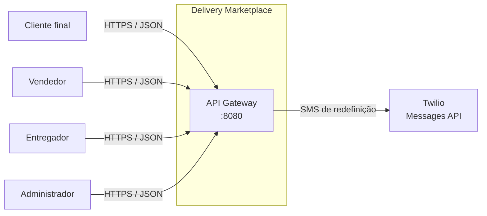

**Atores externos**

| Ator | Relação com o sistema |
|---|---|
| Cliente | Usa a loja web por slug; pode ter conta `CUSTOMER`, mas o checkout web não exige login. |
| Vendedor | Usa a web e o app Android; possui conta `SELLER` vinculada a um tenant. |
| Entregador | Usa o simulador web; possui conta `COURIER` no admin, mas o simulador não autentica. |
| Analista de suporte | Usa o painel web; possui conta `SUPPORT`, sem acesso a usuários ou configurações. |
| Administrador | Usa o painel web; possui conta `ADMIN`. |
| Twilio | Provedor externo de SMS para redefinição de senha. |
| Redpanda | Barramento Kafka que recebe os eventos de pedido. Sem consumidor neste repositório. |
| Gateway de pagamento | **Não integrado**; o pagamento é simulado. |
| Provedor de e-mail/push | **Não integrado**. |

### 3.2 Contexto técnico

| Interface | Direção | Protocolo | Observação |
|---|---|---|---|
| Web/Android → gateway | Entrada | HTTP/JSON | Único ponto de entrada previsto. |
| Gateway → serviços | Interna | HTTP/JSON | Rotas por path; sem descoberta. |
| Identity → Twilio | Saída | HTTPS | Apenas no fluxo de senha. |
| Catalog → tenant | Interna | HTTP/JSON | `RestClient` para resolver a loja atual. |
| Order → tenant | Interna | HTTP/JSON | `RestClient` para resolver a loja atual e no seed. |
| Serviços → PostgreSQL | Saída | JDBC | Um banco lógico por serviço. |
| Order → Redpanda | Saída | Kafka protocol | Producer do tópico `order-events`; publicação assíncrona e opcional. |
| Order → clientes | Saída | SSE | `GET /api/store/me/orders/stream`, mantido em memória por instância. |
| Serviços → Redis | — | — | **Não usado** pelo código atual. |

---

## 4. Estratégia de solução

1. **Gateway como borda**: todas as chamadas dos clientes passam por `:8080`; o gateway aplica CORS, valida JWT nas rotas protegidas e encaminha para o serviço.
2. **Serviços por domínio**: identity, tenant, catalog e order são aplicações Spring Boot independentes, com banco próprio.
3. **Comunicação síncrona para dados**: chamadas HTTP diretas entre serviços quando um precisa de dados de outro; não há Saga nem Outbox.
4. **Tempo real local + barramento**: o order-service publica eventos internos, entrega por SSE às conexões abertas e replica no tópico Kafka `order-events` como *producer*. Não há consumidor no repositório.
5. **Persistência explícita**: cada serviço evolui seu schema com Liquibase e valida o mapeamento JPA com `ddl-auto: validate`.
6. **Frontends separados por canal**: um Next.js multi-perfil para web e um app Android nativo para o vendedor.
7. **Autenticação stateless**: JWT HS256 com claims `sub`, `email`, `role`, `iss`, `iat`, `exp`; sem sessão no servidor.
8. **Multi-tenancy por coluna**: `tenant_id` presente nas tabelas de negócio, mas sem RLS e com resolução simplificada da loja atual.

---

## 5. Visão de blocos

### 5.1 Containers (C4 nível 2)

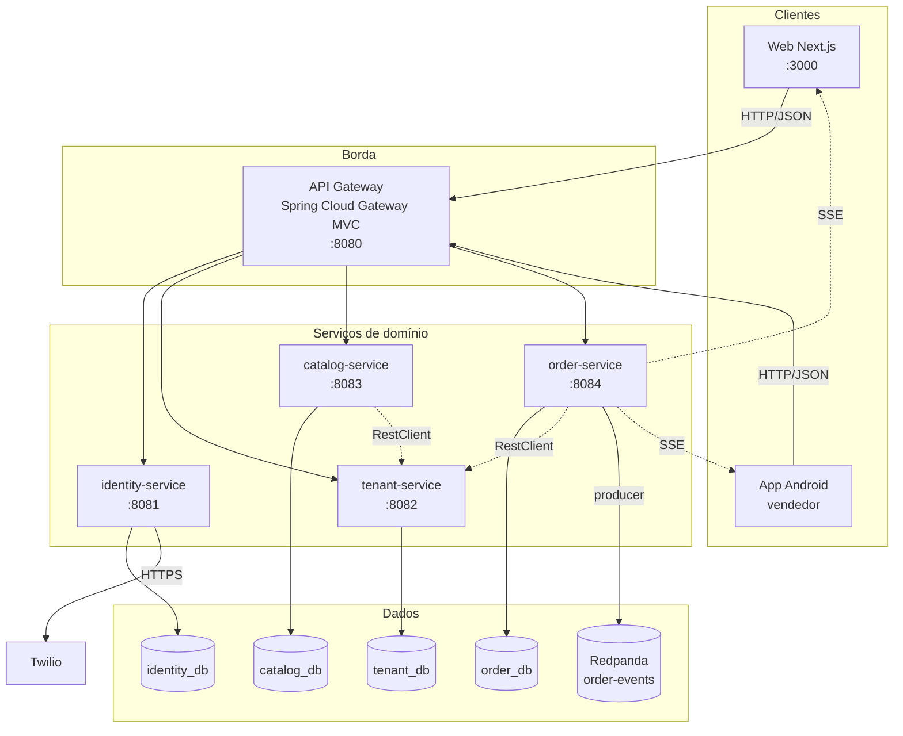

### 5.2 Catálogo de containers

| Container | Porta | Responsabilidade | Banco | Dependências |
|---|---|---|---|---|
| **Web** | `3000` | Quatro perfis web: cliente, vendedor, entregador e admin. | — | Gateway |
| **Android vendedor** | — | App vendedor: login, loja, pagamentos, pedidos, cardápio e agenda de produção. | `EncryptedSharedPreferences` | Gateway |
| **API Gateway** | `8080` | Roteamento, CORS, validação JWT, Swagger agregado. | — | Serviços |
| **identity-service** | `8081` | Autenticação, usuários, JWT, senha, configurações e auditoria. | `identity_db` | PostgreSQL, Twilio |
| **tenant-service** | `8082` | Lojas, tema, entregadores e configurações do app vendedor. | `tenant_db` | PostgreSQL |
| **catalog-service** | `8083` | Pratos, categorias, disponibilidade, esforço de cozinha e cardápio do vendedor. | `catalog_db` | PostgreSQL, tenant |
| **order-service** | `8084` | Pedidos, itens, agenda de produção, fila do vendedor, pedidos de balcão, SSE e producer Kafka. | `order_db` | PostgreSQL, tenant, catálogo, Redpanda |
| **PostgreSQL** | `5432` | Infraestrutura de dados. | 4 bancos | Docker |
| **Redis** | `6379` | Provisionado, **não usado**. | — | Docker |
| **Redpanda** | `19092`/`9644` | Barramento Kafka; recebe `order-events` do order-service. Sem consumidores no repositório. | — | Docker |

### 5.3 Rotas do gateway

A ordem das rotas importa: as mais específicas vêm antes de `/api/store/**`.

| Ordem | Rota | Destino | Path |
|---|---|---|---|
| 1 | `identity-service` | `http://localhost:8081` | `/api/auth/**` |
| 2 | `store-catalog` | `http://localhost:8083` | `/api/store/me/dishes/**` |
| 3 | `store-orders` | `http://localhost:8084` | `/api/store/me/orders/**` |
| 4 | `store-service` | `http://localhost:8082` | `/api/store/**` |
| 5 | `tenant-service` | `http://localhost:8082` | `/api/tenants/**` |
| 6 | `catalog-service` | `http://localhost:8083` | `/api/catalog/**` |
| 7 | `order-service` | `http://localhost:8084` | `/api/orders/**` |
| 8 | `docs-identity` | `http://localhost:8081` | `/v3/api-docs/identity` → `/v3/api-docs` |
| 9 | `docs-tenant` | `http://localhost:8082` | `/v3/api-docs/tenant` → `/v3/api-docs` |
| 10 | `docs-catalog` | `http://localhost:8083` | `/v3/api-docs/catalog` → `/v3/api-docs` |
| 11 | `docs-order` | `http://localhost:8084` | `/v3/api-docs/order` → `/v3/api-docs` |

O gateway usa `spring.cloud.gateway.server.webmvc.routes`, ou seja, a variante **servlet/MVC**. Não há filtro de rate limit, retry, circuit breaker ou remoção de headers internos.

### 5.4 Blocos internos por serviço

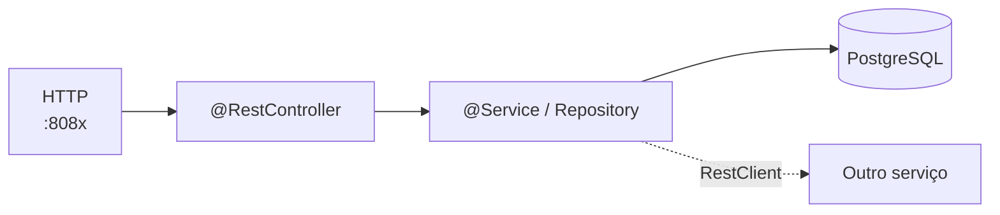

| Serviço | Controllers | Serviços / repositórios | Observações |
|---|---|---|---|
| identity | `AuthController` | `AuthService`, `AdminConfigurationService`, `TwilioSmsService`, `UserRepository`, `PasswordResetTokenRepository`, `PlatformSettingsRepository`, `AdminAuditRepository` | Segurança própria com Spring Security Resource Server. |
| tenant | `TenantController`, `StoreController` | `TenantService`, `TenantRepository`, `CourierRepository` | `StoreController` resolve a loja atual pela primeira loja ativa. |
| catalog | `CatalogController`, `StoreCatalogController` | `CatalogService`, `DishRepository`, `TenantLookup` | Escritas públicas; listagem do vendedor não filtra por loja. |
| order | `OrderController`, `StoreOrderController` | `OrderService`, `OrderRepository`, `TenantLookup`, `SchedulingService`, `CatalogLookup`, `OrderEventDispatcher`, `KafkaOrderEventPublisher`, seeders | Sem segurança própria; status livre. Reserva agenda na criação e emite SSE/Kafka após o commit. |
| gateway | — | `SecurityConfiguration`, `CorsConfiguration`, `JwtConfiguration`, `OpenApiConfig` | Valida JWT e agrega documentação. |

### 5.5 Estrutura de pacotes

```text
com.delivery.<serviço>
├── config/        # segurança, OpenAPI, seeders
├── controller/    # endpoints HTTP
├── dto/           # contratos de entrada/saída
├── model/         # entidades JPA e enums
├── repository/    # Spring Data JPA
└── service/       # regras e integrações
```

---

## 6. Visão de runtime

### 6.1 Login

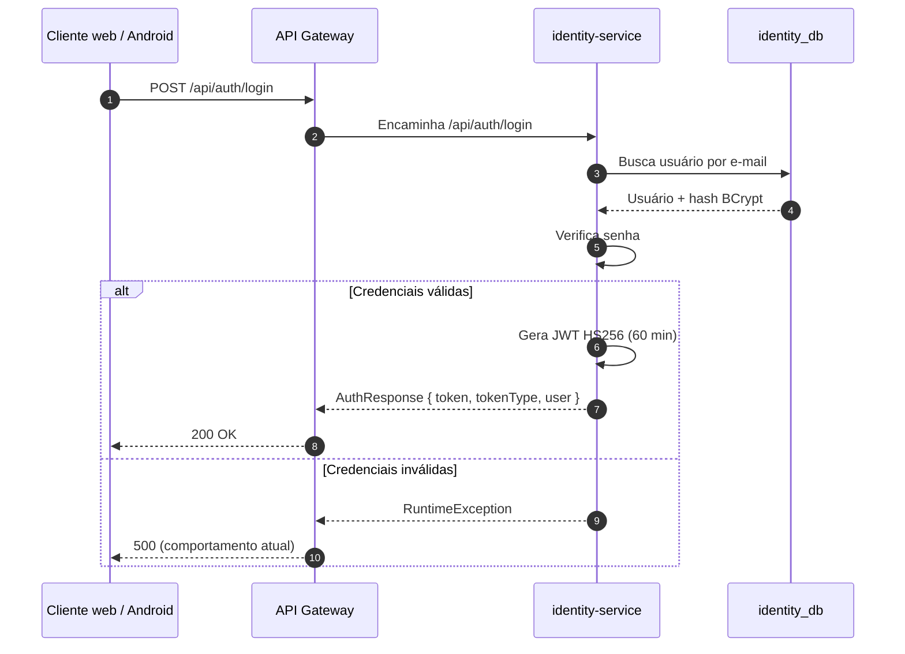

### 6.2 Navegação da loja

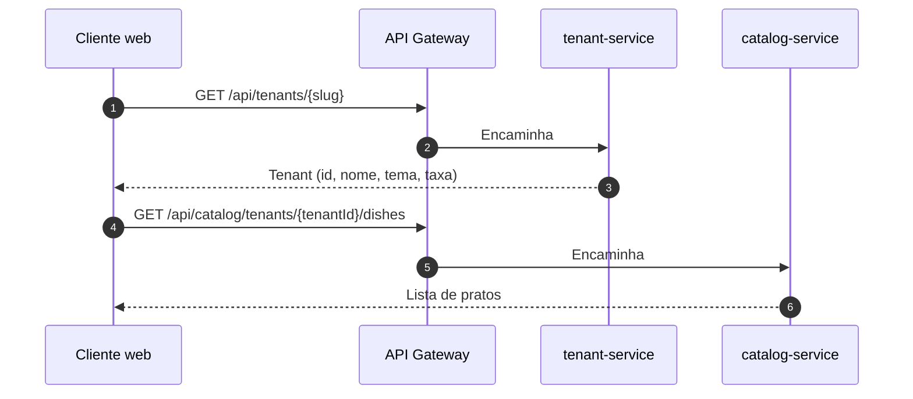

### 6.3 Criação de pedido

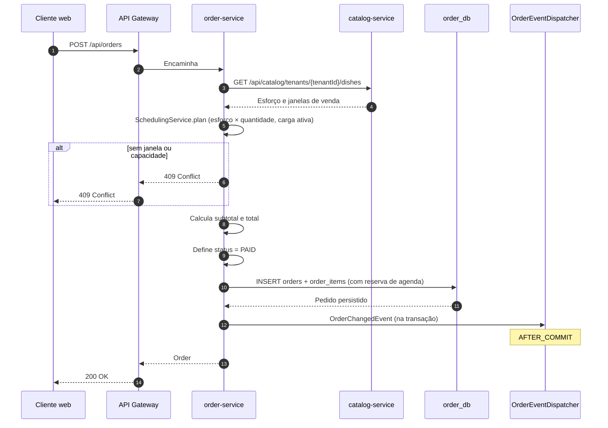

O serviço consulta o catálogo com timeout de 2 s. Se o catálogo estiver fora do ar, usa o `effortMinutes` enviado no request e, na falta dele, o default `20`; as janelas caem no fallback `1..6`/`11:00-15:00`/`18:00-23:00`. A criação **não** valida preço do prato, disponibilidade, taxa ou se o `tenantId` existe. A taxa padrão é `R$ 7,00` quando não enviada.

Após o commit, o `OrderEventDispatcher` entrega o evento por SSE e o publica no Redpanda. A publicação roda em thread própria: broker fora do ar gera `WARN` e **não** falha o checkout.

### 6.4 Fila e ações do vendedor

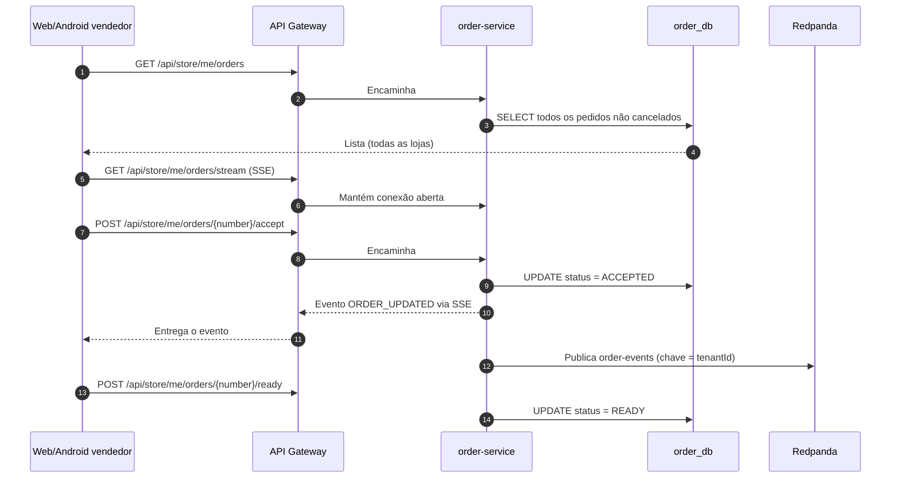

O SSE mantém o registro de conexões **em memória** (`SseOrderEventRegistry`). Com mais de uma instância do order-service, cada vendedor só recebe eventos da instância à qual está conectado. Escalar horizontalmente exige consumir o `order-events` por instância ou um gateway de tempo real.

A **fila de preparo é FIFO** por `orders.preparing_at`: o primeiro aceite (ou a criação de um pedido de balcão) grava o instante de entrada, e um pedido recém-aceito entra no fim, sem deslocar quem já estava preparando. O campo não é sobrescrito em `ACCEPTED → PREPARING` nem em `PREPARING → READY`.

### 6.5 Pedido de balcão

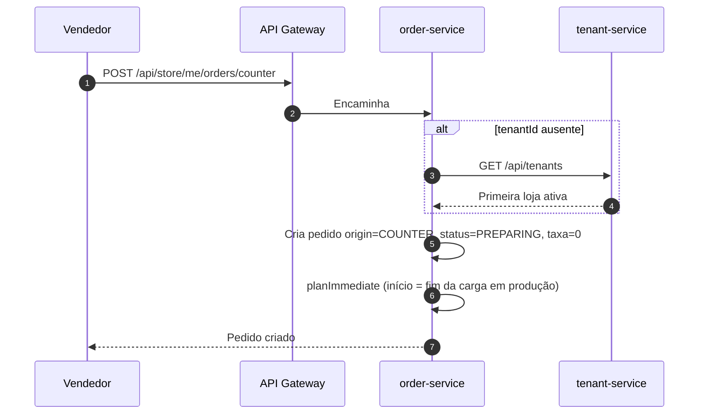

### 6.6 Fluxo do entregador (web)

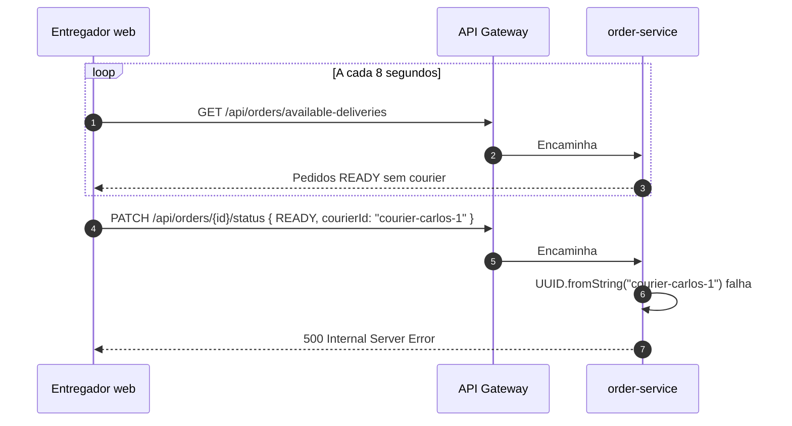

O fluxo pretendido é aceitar a corrida, retirar e entregar. O fluxo real falha no aceite por causa do identificador inválido. Ver [`03-api.md`](03-api.md#11-lacunas-conhecidas-do-contrato).

### 6.7 Configurações e auditoria

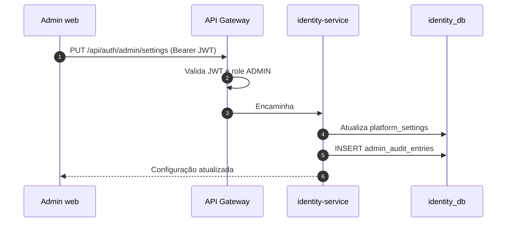

### 6.8 Redefinição de senha

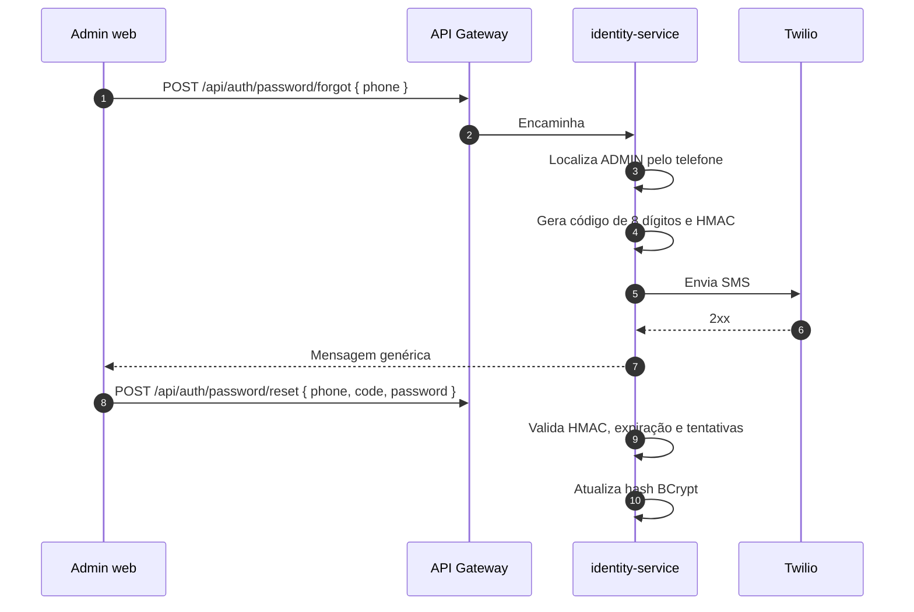

### 6.9 Agenda de produção e agenda pública

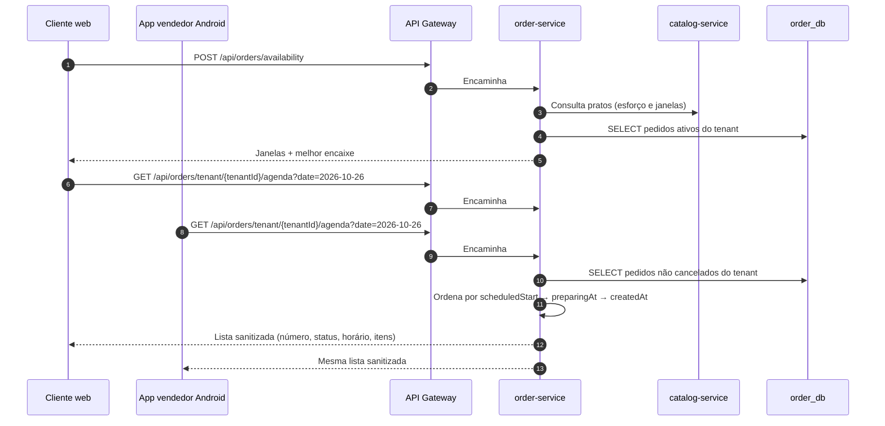

O encaixe é calculado em memória a partir dos pedidos ativos (`PAID`, `ACCEPTED`, `PREPARING`) e dos campos `reserved_effort_minutes`, `scheduled_start`, `scheduled_end` e `scheduled_window`. Não há tabela de slots, lock distribuído nem reagendamento: duas criações simultâneas podem reservar o mesmo intervalo.

A agenda pública filtra os pedidos do dia, exclui `CANCELLED` e devolve `AgendaEntryDto` sem nome, telefone, endereço ou valores. A web do cliente e a aba **Agenda** do app vendedor consomem o mesmo endpoint e atualizam a tela a cada 30 s; não há SSE para a agenda.

---

## 7. Visão de implantação

### 7.1 Topologia local

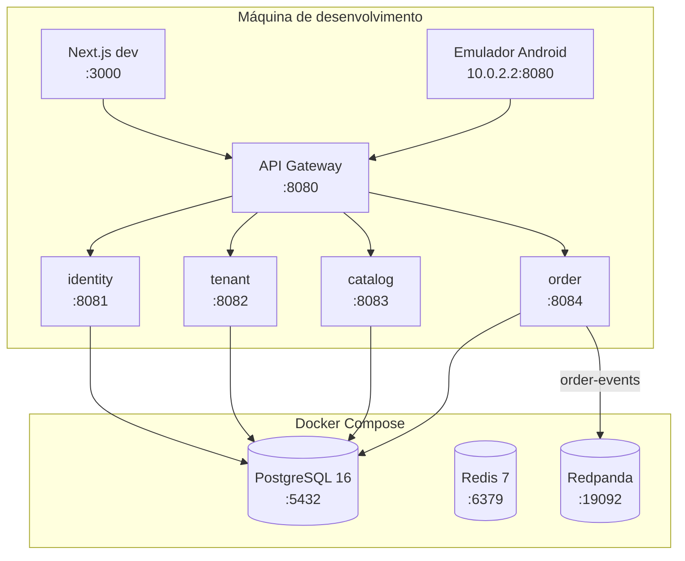

Cada nó de aplicação é um repositório Git independente, materializado como submódulo do guarda-chuva. A topologia acima descreve processos, não repositórios: todos rodam na mesma máquina, a partir de checkouts distintos.

### 7.2 Portas e bancos

| Componente | Porta | Banco / URL |
|---|---|---|
| Web | `3000` | — |
| Gateway | `8080` | — |
| identity | `8081` | `identity_db` |
| tenant | `8082` | `tenant_db` |
| catalog | `8083` | `catalog_db` |
| order | `8084` | `order_db` |
| PostgreSQL | `5432` | `postgres/postgrespassword` (dev) |
| Redis | `6379` | não usado |
| Redpanda | `19092` (externo), `9644` (admin) | `order-events` (producer do order) |
| Android debug | — | `http://10.0.2.2:8080/api/` |

### 7.3 O que não existe na implantação

- Dockerfiles para os serviços, frontend ou Android.
- Pipeline de CI/CD por repositório ou pipeline de integração no guarda-chuva.
- Manifestos Kubernetes, Helm, Terraform ou GitOps.
- Reverse proxy, TLS, CDN ou WAF.
- Health check de dependências no gateway.
- Separação de redes ou mTLS entre serviços.
- Estratégia de backup/restore documentada no repositório.

---

## 8. Conceitos transversais

### 8.1 Segurança

- JWT HS256, emissor `deliveryhub-identity`, TTL de 60 minutos.
- Claims: `sub` (UUID do usuário), `email`, `role`, `iss`, `iat`, `exp`.
- Gateway valida assinatura, emissor e expiração sempre que recebe um Bearer token; sem token, aplica a regra de rota.
- Identity repete a validação e a autorização, inclusive em chamadas diretas.
- Tenant, catalog e order **não têm Spring Security**; dependem do gateway.
- Não há `tenant_id` no JWT; a loja atual é inferida pela primeira loja ativa.
- Detalhes e lacunas em [`06-seguranca.md`](06-seguranca.md).

### 8.2 Persistência

- Um banco por serviço, sem FK entre bancos.
- Liquibase em SQL, com `includeAll` da pasta `changes`.
- `ddl-auto: validate` impede criação automática de schema.
- Entidades usam UUID; `orders` e `order_items` têm relacionamento JPA com cascade.
- Campos JSON (`options_json`, `sales_days_json`, `sales_windows_json`) são `TEXT` e tratados como string.
- Detalhes em [`04-dados.md`](04-dados.md).

### 8.3 Tratamento de erros

- Não há `@ControllerAdvice` nem contrato único de erro.
- `ResponseStatusException` é usado em alguns fluxos (404, 400, 409, 503).
- `RuntimeException` em fluxos de login, busca de loja/pedido e duplicidade resulta em 500.
- O frontend normaliza `message`, `detail`, `title`, `error`, `errors` e `violations` em `apiClient.ts`.
- O app Android classifica falhas em `AppViewModel` e exibe `UiFeedback`.
- Ver [`03-api.md`](03-api.md#8-códigos-de-status-e-erros).

### 8.4 Validação

- DTOs de identity, tenant e order usam Jakarta Validation (`@NotBlank`, `@NotNull`, `@Email`, `@Min`, `@DecimalMin`, `@NotEmpty`).
- Catalog aceita a entidade `Dish` diretamente em alguns endpoints; `DishRequest` é usado no store.
- `PATCH /api/orders/{id}/status` não valida `status` nem `courierId` antes de converter.
- Não há validação de transição de status, preço ou disponibilidade.

### 8.5 Configuração

- `application.yml` por serviço, com variáveis de ambiente e defaults de desenvolvimento.
- `JWT_SECRET` deve ser igual no gateway e no identity, com pelo menos 32 bytes.
- `APP_SEED_DEMO_DATA=true` ativa seeders condicionais.
- `SPRING_DATASOURCE_*` permite apontar para outro PostgreSQL.
- `KAFKA_BOOTSTRAP_SERVERS`, `KAFKA_ENABLED` e `KAFKA_ORDER_TOPIC` controlam a publicação de eventos no order-service.
- `CATALOG_SERVICE_URL` define o catálogo consultado pelo order-service; `SCHEDULING_DEFAULT_EFFORT_MINUTES` e `SCHEDULING_MAX_DAYS_AHEAD` ajustam a agenda.
- `NEXT_PUBLIC_API_URL` define a URL do gateway no frontend.
- `API_BASE_URL` (propriedade Gradle) define a URL no Android.

### 8.6 Logging

- Configuração padrão com `root: INFO` e níveis `DEBUG`/`TRACE` para Spring, Hibernate e o pacote `com.seuprojeto` (nome genérico, sem relação com o código).
- Não há logs estruturados, correlation ID, mascaramento de PII ou agregador.
- Logs de erro do Twilio não registram o código SMS, mas registram a mensagem da exceção.

### 8.7 Multi-tenancy

- `tenant_id` existe em `couriers`, `dishes`, `orders` e `users`.
- Não há RLS, constraint composta ou filtro obrigatório.
- `GET /api/store/me/orders` retorna pedidos de todas as lojas.
- `GET /api/store/me/dishes` retorna pratos de todas as lojas.
- `StoreController.currentTenant()` e `TenantLookup.resolve()` escolhem a primeira loja ativa.
- O JWT não carrega `tenant_id`.
- Detalhes e riscos em [`04-dados.md`](04-dados.md#8-multi-tenancy) e [`06-seguranca.md`](06-seguranca.md).

### 8.8 CORS

- Configurado no gateway para `/api/**`.
- Origens padrão: `http://localhost:*`, `http://127.0.0.1:*`, `http://192.168.*:*`, `http://10.*:*`, `http://172.16.*:*`.
- Métodos: `GET`, `POST`, `PUT`, `PATCH`, `DELETE`, `OPTIONS`.
- Headers: `*`; credenciais: `true`; `maxAge`: 3600.
- Em produção, restringir a origens explícitas.

### 8.9 Contratos e documentação

- OpenAPI gerado por springdoc em cada serviço.
- Gateway agrega via Swagger UI com seleção de definição.
- Não há versionamento de API, lint de contrato ou teste de contrato.
- A referência textual está em [`03-api.md`](03-api.md).

### 8.10 Mensageria e tempo real

- `OrderService` publica `OrderChangedEvent` internamente na mesma transação.
- `OrderEventDispatcher` escuta com `@TransactionalEventListener(AFTER_COMMIT)` e distribui o evento.
- `SseOrderEventRegistry` mantém conexões abertas em memória e entrega a vendedores da mesma loja resolvida.
- `KafkaOrderEventPublisher` publica no tópico `order-events`, com chave `tenantId` para preservar ordem por loja.
- A publicação é assíncrona em thread própria, com timeout curto; broker indisponível não bloqueia o pedido.
- `KAFKA_ENABLED=false` desliga o producer e mantém o SSE.
- **Não há consumidor.** O tópico existe para um futuro `notification-service` (FCM).
- O payload é o mesmo `StoreOrderDto` da listagem e contém dados do cliente (nome, telefone, endereço) — trate o tópico como dado pessoal.
- Detalhes do contrato em [`../tempo-real-pedidos.md`](../tempo-real-pedidos.md).

---

## 9. Decisões arquiteturais

| ADR | Decisão | Status |
|---|---|---|
| [`0001`](09-decisoes/0001-microsservicos-e-api-gateway.md) | Manter microsserviços com API Gateway | Aceito |
| [`0002`](09-decisoes/0002-database-per-service-e-liquibase.md) | Database-per-service com Liquibase | Aceito |
| [`0003`](09-decisoes/0003-jwt-hs256-no-gateway-e-identity.md) | JWT HS256 no gateway e no identity | Aceito |
| [`0004`](09-decisoes/0004-frontend-nextjs-unico.md) | Um frontend Next.js multi-perfil | Aceito |
| [`0005`](09-decisoes/0005-documentacao-como-codigo.md) | Documentação como código | Aceito |
| [`0006`](09-decisoes/0006-postgresql-como-fonte-de-verdade.md) | PostgreSQL como fonte de verdade | Aceito |
| [`0007`](09-decisoes/0007-pagamento-simulado-no-order-service.md) | Pagamento simulado no Order Service | Aceito (MVP) |
| [`0008`](09-decisoes/0008-eventos-de-pedido-com-sse-e-kafka.md) | Eventos de pedido por SSE e Kafka | Aceito |
| [`0009`](09-decisoes/0009-agenda-de-producao-por-esforco.md) | Agenda de produção por esforço | Aceito |
| [`0010`](09-decisoes/0010-cadastro-de-usuarios-por-perfil-e-tenant.md) | Cadastro de usuários por perfil e tenant | Aceito |
| [`0011`](09-decisoes/0011-polyrepo-com-submodulos.md) | Polyrepo com submódulos Git | Aceito |

---

## 10. Requisitos de qualidade

| ID | Cenário | Resposta esperada | Medida | Situação |
|---|---|---|---|---|
| QA-01 | Cliente cria pedido com itens válidos | Pedido persistido e retornado com total correto | ≤ 2 s em ambiente local | Não medido |
| QA-02 | Vendedor abre a fila | Pedidos não cancelados visíveis | ≤ 2 s | Não medido |
| QA-03 | Usuário sem token tenta alterar catálogo | Requisição negada | 401/403 | **Falha**: endpoint público |
| QA-04 | Vendedor da loja A lista pedidos | Apenas pedidos da loja A | 0 vazamentos | **Falha**: retorna todas |
| QA-05 | Token expirado | Sessão encerrada e login solicitado | 401 + redirecionamento | Implementado no admin; parcial no vendedor |
| QA-06 | Serviço de tenant indisponível | Catalog/order degradam com mensagem clara | Erro controlado | Parcial: `RestClient` sem timeout explícito |
| QA-07 | Ação administrativa | Evento de auditoria persistido | 100% das ações | Parcial: só ações implementadas |
| QA-08 | Erro de validação no formulário | Mensagem útil e sem stack trace | Feedback amigável | Parcial: depende do backend |
| QA-09 | Reinício do ambiente | Dados preservados no volume | Sem perda | Implementado no Docker; sem backup |
| QA-10 | Novo desenvolvedor sobe o ambiente | Build + primeira chamada em até 60 min | ≤ 60 min | Não medido |

> As metas são propostas iniciais. Sem métricas e testes de carga, não há evidência para afirmar que são atendidas.

---

## 11. Riscos e dívida técnica

| Risco | Impacto | Evidência | Mitigação recomendada |
|---|---|---|---|
| Escritas públicas em catálogo e pedidos | Qualquer pessoa altera preços, pratos e status | Gateway `anyRequest().permitAll()`; serviços sem Security | Autorização por papel e tenant; testes de segurança |
| Loja atual inferida pela primeira ativa | Vazamento e operação na loja errada | `StoreController.currentTenant`, `TenantLookup.resolve` | `tenant_id` no JWT e filtro obrigatório |
| Pagamento simulado | Não há cobrança, conciliação ou estorno | `status = PAID` direto no `createOrder` | Integrar PSP, webhook e idempotência |
| Ausência de máquina de estados | Status inconsistente e ações fora de ordem | `updateStatus` aceita qualquer enum | Validar transições e histórico |
| `courierId` inválido no web | Aceite de entrega falha com 500 | `courier-carlos-1` + `UUID.fromString` | Usar UUID real e validar |
| Payload de pagamentos do Android divergente | Alteração não tem efeito | `ProposePaymentsRequest(config)` vs `enabledMethods` | Alinhar contrato e persistir |
| Sem autenticação no vendedor web | Sessão é apenas cosmética | `api.ts` não envia `Authorization` | Interceptor e proteção de rotas |
| Segredo JWT padrão | Tokens forjáveis se o default for usado | `application.yml` | Exigir segredo forte por ambiente |
| Sem idempotência | Pedidos duplicados em retry | `POST /api/orders` sem chave | `Idempotency-Key` e unique constraint |
| Sem testes de comportamento | Regressões silenciosas | Apenas `contextLoads()` | Pirâmide de testes e CI |
| Sem observabilidade | Diagnóstico lento | Apenas `/actuator/health` | Métricas, tracing e logs estruturados |
| `localhost` fixo no gateway | Não escala nem containeriza | `application.yml` | Descoberta de serviço ou configuração por ambiente |
| Migração `002-clear-preloaded-data` | Apaga dados na primeira execução | Changeset de limpeza | Revisar antes de produção; backup |
| JSON como `TEXT` | Sem validação e difícil consultar | Campos `*_json` | Modelar ou validar JSON |
| Sem versionamento de API | Quebra de clientes | Rotas `/api` sem versão | Versionar e testar contrato |
| CORS amplo | Superfície de ataque | Padrões de rede privada | Restringir origens |
| Redis sem uso | Custo e falsa impressão de capacidade | `docker-compose.yml` | Remover ou implementar |
| Kafka sem consumidor | Eventos publicados sem destino; custo operacional | `KafkaOrderEventPublisher` | Implementar `notification-service` ou desligar `KAFKA_ENABLED` |
| SSE em memória | Não escala horizontalmente | `SseOrderEventRegistry` | Consumir `order-events` por instância ou gateway de tempo real |
| Dependência H2 sem configuração | Confusão no onboarding | POMs + README | Remover ou criar perfil de teste |
| Seed de pedido depende do tenant | Startup lento ou sem dado | `OrderDataSeeder` | Desacoplar ou tornar condicional |

---

## 12. O que é alvo e o que é implementado

| Capacidade | `docs/arquitetura.md` (alvo) | Código atual |
|---|---|---|
| BFFs por app | Sim | Não |
| Kafka/Redpanda | Sim | Producer do `order-events` implementado; sem consumidores |
| Saga/Outbox | Sim | Não |
| Payment/Settlement | Sim | Não; pagamento simulado |
| Dispatch/Tracking | Sim | Não |
| Search/Media/Notification | Sim | Não |
| WebSocket/MQTT | Sim | Não; SSE + polling no entregador |
| RLS/multi-tenancy forte | Sim | Parcial |
| Kubernetes/IaC | Sim | Não |
| Observabilidade completa | Sim | Actuator básico |
| App cliente Android/iOS | Sim | Não; só web |
| Deep links | Sim | Não |

A leitura correta é: **`docs/arquitetura.md` é o roadmap arquitetural; este documento é o as-is**.

---

## 13. Glossário

O glossário do produto está em [`01-visao-geral.md`](01-visao-geral.md#9-glossário). Termos específicos de arquitetura:

| Termo | Definição |
|---|---|
| **As-is** | Arquitetura implementada e observável. |
| **To-be** | Arquitetura-alvo descrita no documento histórico. |
| **Gateway MVC** | Variante servlet do Spring Cloud Gateway, baseada em `spring-cloud-starter-gateway-server-webmvc`. |
| **Database-per-service** | Cada serviço tem seu banco lógico e não acessa o banco de outro. |
| **RestClient** | Cliente HTTP síncrono do Spring usado nas integrações internas. |
| **Seed** | Carga inicial de dados. |
| **Demo data** | Dados fictícios ativados por flag. |
| **Actuator** | Módulo Spring Boot que expõe endpoints operacionais. |
