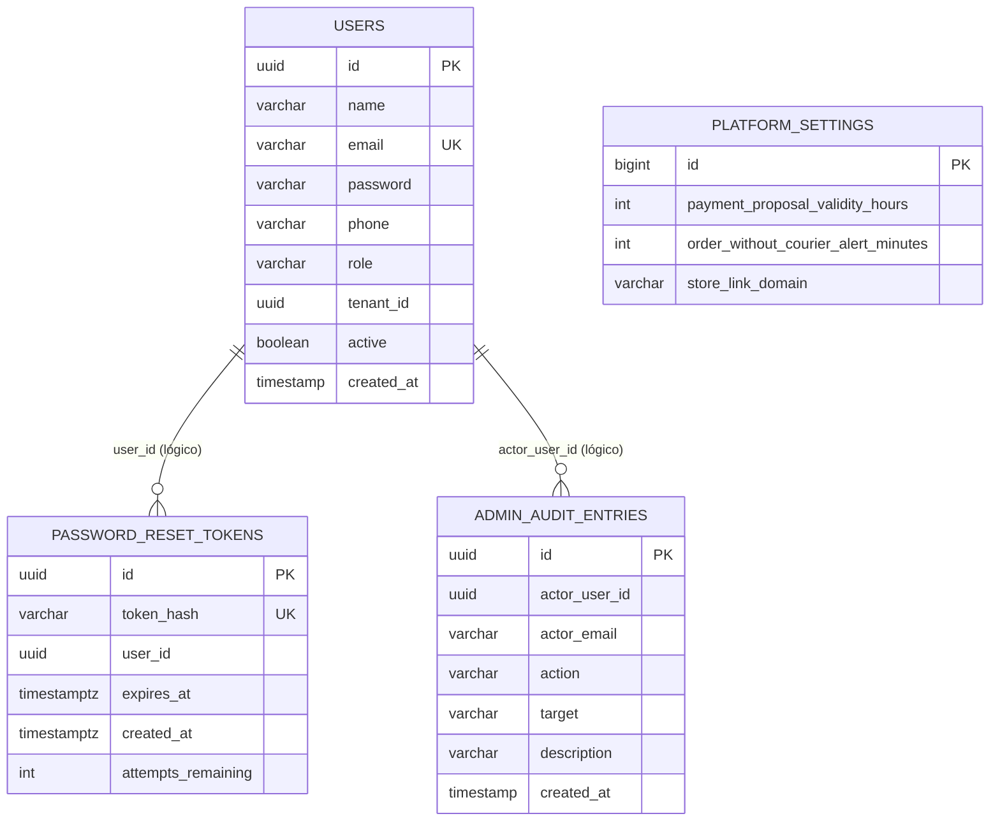
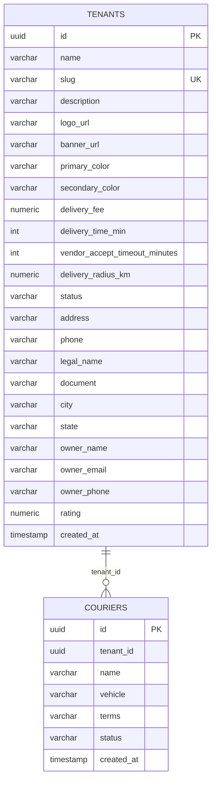
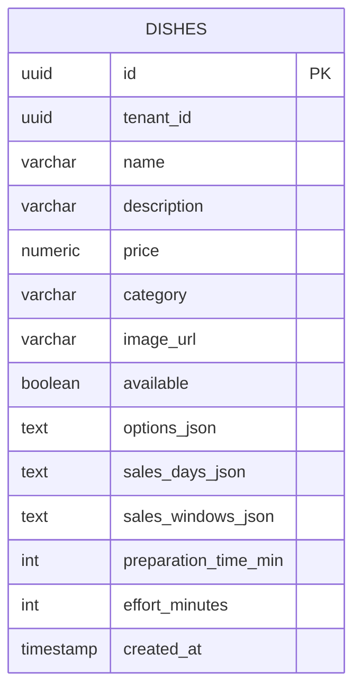
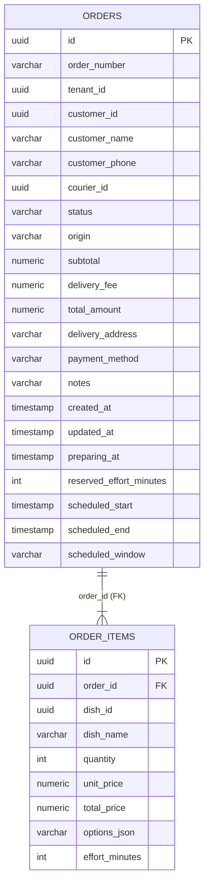

# 04 — Dados

| Campo | Valor |
|---|---|
| Status | Implementado; multi-tenancy parcial |
| Público | Engenharia, DBA, operações, segurança e QA |
| Última revisão | 2026-10-26 |
| Banco | PostgreSQL 16 |
| Migrações | Liquibase (SQL) |
| Fonte de verdade | `db/changelog/changes/*.sql` e entidades JPA |

---

## 1. Princípios

1. **Database-per-service**: cada serviço tem um banco lógico próprio e não acessa o banco de outro.
2. **Sem FK entre serviços**: relações entre domínios são feitas por ID, sem integridade referencial no banco.
3. **Schema versionado**: toda alteração passa por um changeset Liquibase; `ddl-auto` é `validate`.
4. **Snapshot no pedido**: o pedido guarda nome e preço do prato no momento da compra, para preservar o histórico.
5. **Multi-tenancy por coluna**: `tenant_id` existe nas tabelas de negócio, mas não há Row-Level Security.
6. **Dados de demonstração opcionais**: identity, tenant e catalog exigem `app.seed.demo-data=true`; order tem seed próprio.

---

## 2. Bancos e propriedade

| Banco | Serviço dono | Tabelas | Observação |
|---|---|---|---|
| `identity_db` | identity-service | `users`, `platform_settings`, `password_reset_tokens`, `admin_audit_entries` | Fonte de identidade e auditoria. |
| `tenant_db` | tenant-service | `tenants`, `couriers` | Fonte de lojas e entregadores. |
| `catalog_db` | catalog-service | `dishes` | Fonte de cardápio. |
| `order_db` | order-service | `orders`, `order_items` | Fonte de pedidos. |

Os quatro bancos são criados por [`docker/init-db.sql`](../../docker/init-db.sql) na **primeira** inicialização do volume do PostgreSQL. Se o volume já existir, o script não roda novamente.

```sql
CREATE DATABASE identity_db;
CREATE DATABASE tenant_db;
CREATE DATABASE catalog_db;
CREATE DATABASE order_db;
```

---

## 3. Modelo de dados

### 3.1 Identity



| Tabela | Campos principais | Regras |
|---|---|---|
| `users` | `id`, `name`, `email`, `password`, `phone`, `role`, `tenant_id`, `active`, `created_at` | `email` único; `password` BCrypt; `role` é `ADMIN`, `SUPPORT`, `SELLER`, `COURIER` ou `CUSTOMER`; `tenant_id` é lógico, sem FK; `active=false` bloqueia o login; `tenant_id` é obrigatório para `SELLER` e proibido para `ADMIN`/`SUPPORT` na camada de serviço. |
| `platform_settings` | `id=1`, `payment_proposal_validity_hours`, `order_without_courier_alert_minutes`, `store_link_domain` | Linha única; valores padrão `24`, `12`, `deliveryhub.com.br`. |
| `password_reset_tokens` | `id`, `token_hash`, `user_id`, `expires_at`, `created_at`, `attempts_remaining` | `token_hash` único; HMAC-SHA256; 5 tentativas; validade de 10 min. |
| `admin_audit_entries` | `id`, `actor_user_id`, `actor_email`, `action`, `target`, `description`, `created_at` | `action` até 80, `target` até 180, `description` até 500. |

### 3.2 Tenant



| Tabela | Campos principais | Regras |
|---|---|---|
| `tenants` | `id`, `name`, `slug`, `description`, `logo_url`, `banner_url`, `primary_color`, `secondary_color`, `delivery_fee`, `delivery_time_min`, `vendor_accept_timeout_minutes`, `delivery_radius_km`, `status`, dados cadastrais, `rating`, `created_at` | `slug` único; `id` atribuído no `@PrePersist`; `status` textual (`ACTIVE`, `PENDING`, `SUSPENDED` na prática). |
| `couriers` | `id`, `tenant_id`, `name`, `vehicle`, `terms`, `status`, `created_at` | `tenant_id` sem FK; `status` textual (`ONLINE`, `BUSY` na prática). |

### 3.3 Catalog



| Campo | Tipo | Observação |
|---|---|---|
| `id` | UUID | Gerado |
| `tenant_id` | UUID | Obrigatório, sem FK e sem índice |
| `name` | varchar(255) | Obrigatório |
| `description` | varchar(1000) | — |
| `price` | numeric(38,2) | Obrigatório |
| `category` | varchar(255) | Obrigatório |
| `image_url` | varchar(255) | URL externa |
| `available` | boolean | Default `true` na entidade |
| `options_json` | text | JSON como texto |
| `sales_days_json` | text | JSON como texto; adicionado no changeset `003` |
| `sales_windows_json` | text | JSON como texto; adicionado no changeset `003` |
| `preparation_time_min` | integer | Default `25` na entidade; não entra no cálculo da agenda |
| `effort_minutes` | integer | **Implementado.** Default `20`; esforço de cozinha por unidade, adicionado no changeset `004` |
| `created_at` | timestamp | Sem fuso |

### 3.4 Order



| Tabela | Campos principais | Regras |
|---|---|---|
| `orders` | `id`, `order_number`, `tenant_id`, `customer_id`, `customer_name`, `customer_phone`, `courier_id`, `status`, `origin`, `subtotal`, `delivery_fee`, `total_amount`, `delivery_address`, `payment_method`, `notes`, `created_at`, `updated_at`, `preparing_at`, `reserved_effort_minutes`, `scheduled_start`, `scheduled_end`, `scheduled_window` | `order_number` nullable, **sem unique**; `origin` default `APP`; `status` textual; `tenant_id`/`courier_id` sem FK; `preparing_at` marca a entrada na fila de preparo (FIFO) e não é sobrescrito; `scheduled_*` e `reserved_effort_minutes` guardam a reserva da agenda e podem ser nulos em pedidos antigos. |
| `order_items` | `id`, `order_id`, `dish_id`, `dish_name`, `quantity`, `unit_price`, `total_price`, `options_json`, `effort_minutes` | FK real para `orders`; `dish_id` é lógico (cross-service); `options_json` é `varchar(255)`; `effort_minutes` é o snapshot do esforço por unidade. |

---

## 4. Migrações Liquibase

### 4.1 Estrutura

```text
order-service/src/main/resources/db/changelog/
├── db.changelog-master.yaml
└── changes/
    ├── 001-initial-schema.sql
    ├── 002-clear-preloaded-data.sql
    ├── 003-add-order-number.sql
    ├── 004-add-order-origin.sql
    ├── 005-add-preparing-at.sql
    └── 006-add-order-scheduling.sql

catalog-service/src/main/resources/db/changelog/
├── db.changelog-master.yaml
└── changes/
    ├── 001-initial-schema.sql
    ├── 002-clear-preloaded-data.sql
    ├── 003-add-dish-fields.sql
    └── 004-add-dish-effort.sql
```

O master usa `includeAll`:

```yaml
databaseChangeLog:
  - includeAll:
      path: changes
      relativeToChangelogFile: true
      errorIfMissingOrEmpty: true
```

Consequências:

- Todos os arquivos da pasta `changes` são aplicados em ordem lexicográfica.
- O `id` do changeset precisa ser único no serviço.
- Renomear arquivo já aplicado pode causar erro de checksum/ordem.
- O `includeAll` é conveniente para o protótipo, mas exige disciplina em produção.

### 4.2 Changesets por serviço

| Serviço | Changesets | Observação |
|---|---|---|
| identity | `identity-001` a `008` | Cria usuários, settings, reset e auditoria; `006` limpa dados; `007` adiciona `users.active`; `008` recria a constraint `users_role_check` incluindo `SUPPORT`. |
| tenant | `tenant-001`, `tenant-002`, `tenant-003` | Cria tenants; `002` limpa; `003` cria couriers. |
| catalog | `catalog-001` a `004` | Cria dishes; `002` limpa; `003` adiciona campos JSON; `004` adiciona `effort_minutes` com default `20`. |
| order | `order-001` a `006` | Cria orders/items; `002` limpa; `003` adiciona `order_number`; `004` adiciona `origin`; `005` adiciona `preparing_at` e preenche a fila existente; `006` adiciona reserva de agenda (`reserved_effort_minutes`, `scheduled_start`, `scheduled_end`, `scheduled_window`) e `order_items.effort_minutes`. |

### 4.3 Atenção: changesets destrutivos

Os arquivos `002-clear-preloaded-data.sql` executam `DELETE` em massa:

- identity: `password_reset_tokens`, `admin_audit_entries`, `users`, `platform_settings`.
- tenant: `tenants` (e, por consequência, os couriers não são apagados explicitamente).
- catalog: `dishes`.
- order: `order_items`, `orders`.

Em um banco novo, as tabelas estão vazias e o efeito é nulo. Em um banco existente que ainda não aplicou esses changesets, **os dados são apagados**. Antes de promover qualquer ambiente, verifique `DATABASECHANGELOG` e faça backup. Para produção, considere remover ou isolar esses changesets.

### 4.4 Regras para novas migrações

1. Nunca editar um changeset já aplicado; criar um novo.
2. Usar nomes claros: `005-add-payment-settings.sql`.
3. Incluir rollback quando possível; quando não, documentar o motivo.
4. Testar em banco vazio **e** em banco com dados existentes.
5. Evitar `DELETE`/`DROP` sem backup e aprovação.
6. Criar índices para consultas por `tenant_id`, `status`, `courier_id` e `created_at` quando o volume justificar.
7. Não criar FK entre bancos de serviços diferentes.
8. Atualizar [`04-dados.md`](04-dados.md) no mesmo PR.

### 4.5 Verificação

```sql
-- Changesets aplicados
SELECT id, author, filename, dateexecuted, orderexecuted, exectype
FROM public.databasechangelog
ORDER BY orderexecuted DESC;

-- Tabelas por banco
\dt
```

---

## 5. Seeds e dados de demonstração

### 5.1 Matriz de seeds

| Serviço | Classe | Condição | Idempotência | Dados |
|---|---|---|---|---|
| identity | `DataSeeder` | `app.seed.demo-data=true` **e** `users.count() == 0` | Sim | Admin, support, seller, courier e customer. |
| tenant | `DataSeeder` | `app.seed.demo-data=true` **e** `tenants.count() == 0` | Sim | 3 lojas com IDs fixos. |
| catalog | `DataSeeder` | `app.seed.demo-data=true` **e** `dishes.count() == 0` | Sim | 7 pratos. |
| tenant | `StoreDataSeeder` | **Sempre**; primeira loja sem couriers | Sim | 2 entregadores. |
| order | `DataSeeder` | `app.seed.demo-data=true` **e** `orders.count() == 0` | Sim | 2 pedidos (`PREPARING`, `READY`). |
| order | `OrderDataSeeder` | **Sempre**; `orders.count() == 0` e tenant acessível | Sim | 1 pedido `4822` (`PAID`). |

### 5.2 Contas demo

Com `app.seed.demo-data=true` no identity:

| Papel | E-mail | Senha | Telefone | `tenantId` |
|---|---|---|---|---|
| ADMIN | `admin@delivery.com` | `admin123` | `ADMIN_PHONE` ou nulo | — |
| SUPPORT | `suporte@delivery.com` | `suporte123` | `(11) 99999-0005` | — |
| SELLER | `joao@pizzaria.com` | `loja123` | `(11) 99999-0002` | `11111111-1111-1111-1111-111111111111` |
| COURIER | `carlos@moto.com` | `entrega123` | `(11) 99999-0003` | — |
| CUSTOMER | `maria@gmail.com` | `cliente123` | `(11) 99999-0004` | — |

> `ADMIN_PHONE` só é usado na criação inicial. Alterar a variável depois não atualiza um usuário já existente. Sem telefone, a redefinição de senha do admin não funciona.

### 5.3 Lojas demo

| ID | Nome | Slug | Taxa | Prazo |
|---|---|---|---|---|
| `11111111-1111-1111-1111-111111111111` | Pizzaria do João | `pizzaria-do-joao` | `6.90` | 35 min |
| `22222222-2222-2222-2222-222222222222` | Burger King Artesanal | `burger-artesanal` | `7.50` | 30 min |
| `33333333-3333-3333-3333-333333333333` | Sushi Prime Delivery | `sushi-prime` | `9.90` | 45 min |

### 5.4 Riscos dos seeds

- `OrderDataSeeder` roda **sem** a flag de demo data. Em um banco vazio, ele cria o pedido `4822` desde que o tenant-service responda.
- Ele tenta o tenant-service 5 vezes, com 1,5 s de intervalo; isso pode atrasar o startup do order-service.
- `StoreDataSeeder` roda sempre e cria entregadores na primeira loja.
- Os dois seeders de order podem competir quando `demo-data=true`: ambos verificam `count() == 0`, mas a ordem não é determinística. O resultado pode ser o pedido `4822` ou os dois pedidos de demonstração.
- Seeds não preenchem dados parciais: se houver um registro, o seeder não completa o restante.
- Não há seed de pagamentos, configurações de loja ou histórico.

---

## 6. Geração de identificadores e valores

| Item | Estratégia |
|---|---|
| `User.id` | `GenerationType.UUID` |
| `PlatformSettings.id` | Fixo `1` |
| `PasswordResetToken.id` | `GenerationType.UUID` |
| `AdminAuditEntry.id` | `GenerationType.UUID` |
| `Tenant.id` | Atribuído no `@PrePersist` (`UUID.randomUUID()`) |
| `Courier.id` | `GenerationType.UUID` |
| `Dish.id` | `GenerationType.UUID` |
| `Order.id` / `OrderItem.id` | `GenerationType.UUID` |
| `Order.orderNumber` | 4 dígitos aleatórios; 50 tentativas; fallback timestamp |
| `Tenant.slug` | Informado pelo cliente, normalizado para minúsculo |

---

## 7. Integridade e índices

### 7.1 O que existe

- PKs em todas as tabelas.
- Unique em `users.email`, `tenants.slug`, `password_reset_tokens.token_hash`.
- FK real apenas em `order_items.order_id → orders.id`.

### 7.2 O que falta

| Falta | Impacto |
|---|---|
| FK de `couriers.tenant_id` | Entregador órfão se a loja for removida (não há delete hoje). |
| FK de `dishes.tenant_id` | Prato órfão. |
| FK de `orders.tenant_id` | Pedido órfão. |
| FK de `users.tenant_id` | Vínculo quebrado. |
| Unique em `orders.order_number` | Número duplicado em concorrência. |
| Índices por `tenant_id` | Listagens e filtros ficam lentos com volume. |
| Índices por `status`, `courier_id`, `created_at` | Consultas de fila e entregas sem suporte. |
| Optimistic locking | Atualizações concorrentes sobrescrevem estado. |
| Histórico de status | Não há como auditar a evolução do pedido. |
| Soft delete | Exclusões (quando existirem) serão físicas. |

### 7.3 Inconsistências de modelagem

| Item | Detalhe |
|---|---|
| `orders.order_number` | `varchar(20)`, nullable, sem unique, mas usado como identificador nas ações do vendedor. |
| `order_items.options_json` | `varchar(255)`, enquanto `dishes.options_json` é `TEXT`; opções longas podem ser truncadas/rejeitadas. |
| `orders.notes` | `varchar(255)`, enquanto a intenção de observação pode ser maior. |
| Timestamps | `LocalDateTime` (sem fuso) na maioria; `Instant`/`timestamptz` em reset de senha. |
| `tenants.rating` | `numeric(38,2)`, sem cálculo real; valor inicial `4.8`. |
| `tenants.status` / `couriers.status` | Strings livres, sem enum no banco. |
| `users.role` | Enum Java mapeado como string; banco não restringe. |
| `orders.origin` | String livre com default `APP`. |
| `dishes.available` | Nullable no SQL; entidade usa default `true`. |

---

## 8. Multi-tenancy

### 8.1 Como deveria funcionar

- Todo dado de negócio carrega `tenant_id`.
- O `tenant_id` do usuário autenticado define o escopo.
- Consultas e mutações são filtradas por esse valor.
- Um usuário não acessa dados de outra loja.
- Idealmente, RLS no PostgreSQL ou um filtro obrigatório na camada de dados.

### 8.2 Como funciona hoje

| Ponto | Comportamento |
|---|---|
| JWT | Não contém `tenant_id`. |
| `GET /api/store/me` | Retorna a primeira loja ativa. |
| `GET /api/store/me/payments` | Usa a primeira loja ativa. |
| `GET /api/store/me/couriers` | Usa a primeira loja ativa. |
| `GET /api/store/me/orders` | Retorna pedidos de **todas** as lojas. |
| `GET /api/store/me/dishes` | Retorna pratos de **todas** as lojas. |
| `POST /api/store/me/dishes` | Resolve a primeira loja ativa; se falhar, usa o `tenantId` do primeiro prato. |
| `POST /api/orders` | Aceita qualquer `tenantId`, sem validar existência. |
| `GET /api/orders/tenant/{tenantId}` | Filtra pelo ID informado, sem verificar permissão. |
| RLS | Não existe. |
| Filtro global JPA | Não existe. |

### 8.3 Riscos

- Vazamento de pedidos e cardápios entre lojas.
- Alteração de prato de outra loja.
- Operação na loja errada quando há mais de uma loja ativa.
- Impossibilidade de oferecer o mesmo app para vários vendedores com segurança.

### 8.4 Recomendação

1. Incluir `tenant_id` no JWT para `SELLER`/`COURIER`.
2. Criar um `TenantContext` por requisição.
3. Filtrar todas as queries por `tenant_id`.
4. Adicionar constraints/índices e, se possível, RLS.
5. Criar testes automatizados de isolamento entre tenants.
6. Remover a resolução “primeira loja ativa”.

---

## 9. Dados que não são persistidos

| Dado | Onde aparece | Situação |
|---|---|---|
| Métodos de pagamento habilitados | `GET/PUT /api/store/me/payments` | Calculados em memória; default `PIX`/`CARD_ONLINE`. |
| Propostas de pagamento | `/proposals/pending/*` | No-op; `pending` sempre `null`. |
| Distância da entrega | `distanceKm` no DTO do vendedor | Simulada por hash do ID. |
| Tempo restante para aceite | `secondsToAccept` | Calculado a partir de `createdAt` e 300 s. |
| Status do entregador | `couriers.status` | Persistido apenas no seed; sem API de atualização. |
| Disponibilidade online/offline | Tela do entregador | Estado local no navegador. |
| Rastreamento/GPS | — | Não existe. |
| Histórico de status | — | Não existe. |
| Pagamento/cobrança | — | Não existe. |
| Notificações | — | Não existe. |

---

## 10. Ciclo de vida, retenção e LGPD

### 10.1 Dados pessoais identificáveis

| Dado | Tabela | Finalidade |
|---|---|---|
| Nome | `users`, `orders.customer_name`, `couriers.name` | Identificação e operação. |
| E-mail | `users.email`, `admin_audit_entries.actor_email`, `tenants.owner_email` | Login, contato e auditoria. |
| Telefone | `users.phone`, `orders.customer_phone`, `tenants.phone/owner_phone` | Contato e SMS. |
| Endereço | `orders.delivery_address`, `tenants.address` | Entrega. |
| Observações | `orders.notes` | Instruções do pedido. |
| Documento | `tenants.document` | Cadastro da loja. |

A agenda pública (`GET /api/orders/tenant/{tenantId}/agenda`) não lê nem devolve nome, telefone, endereço ou valores. Ela expõe número do pedido, status, janela, horários, esforço e resumo dos itens; ainda assim, o conjunto permite inferir movimento e preferências da loja. Ver [`06-seguranca.md`](06-seguranca.md).

### 10.2 O que não existe

- Política de retenção e descarte.
- Exportação de dados do titular.
- Exclusão/anonimização sob solicitação.
- Consentimento e base legal documentados.
- Criptografia em repouso gerenciada pela aplicação.
- Mascaramento de PII em logs.
- Inventário formal de dados por serviço.
- Processo de resposta a incidente de dados.

### 10.3 Recomendações

1. Mapear dados por serviço e finalidade.
2. Definir prazos de retenção (pedidos, auditoria, reset de senha).
3. Implementar exclusão/anonimização orquestrada.
4. Restringir acesso a produção e auditar consultas.
5. Criptografar backups e volume.
6. Mascarar telefone/e-mail em logs.
7. Registrar base legal e consentimento quando aplicável.
8. Nomear um responsável por privacidade.

---

## 11. Backup, restauração e retenção técnica

O repositório não define política de backup. Para desenvolvimento local:

```bash
# Backup dos quatro bancos
docker exec -t delivery-postgres pg_dumpall -U postgres > backup.sql

# Restauração (em um banco vazio)
docker exec -i delivery-postgres psql -U postgres < backup.sql
```

Recomendações para ambientes reais:

- Backup diário com retenção definida.
- Teste de restauração periódico.
- PITR (point-in-time recovery) quando o RPO exigir.
- Backup separado por serviço para permitir restauração independente.
- Criptografia e controle de acesso ao backup.
- Registro de RPO/RTO por domínio.

---

## 12. Consultas úteis de diagnóstico

```sql
-- Usuários e papéis
SELECT id, email, role, tenant_id, created_at
FROM users
ORDER BY created_at DESC;

-- Lojas e status
SELECT id, slug, name, status, delivery_fee, delivery_radius_km
FROM tenants
ORDER BY created_at;

-- Pratos por loja
SELECT tenant_id, category, count(*), sum(price)
FROM dishes
GROUP BY tenant_id, category
ORDER BY tenant_id, category;

-- Pedidos por status
SELECT status, origin, count(*), sum(total_amount)
FROM orders
GROUP BY status, origin
ORDER BY status;

-- Pedidos sem entregador
SELECT id, order_number, tenant_id, status, created_at
FROM orders
WHERE courier_id IS NULL
ORDER BY created_at;

-- Duplicidade de número de pedido (não deve existir, mas não há unique)
SELECT order_number, count(*)
FROM orders
GROUP BY order_number
HAVING count(*) > 1;

-- Itens de um pedido
SELECT o.order_number, i.dish_name, i.quantity, i.unit_price, i.total_price
FROM orders o
JOIN order_items i ON i.order_id = o.id
WHERE o.order_number = '4822';
```

---

## 13. Checklist de mudança de dados

- [ ] A mudança pertence a um único serviço.
- [ ] Existe um novo changeset, sem editar os anteriores.
- [ ] O rollback foi definido ou justificado.
- [ ] O changeset foi testado em banco vazio e com dados.
- [ ] Índices foram avaliados para novas consultas.
- [ ] Não há FK entre bancos diferentes.
- [ ] `tenant_id` foi incluído quando o dado é de negócio.
- [ ] A entidade JPA continua compatível com `ddl-auto: validate`.
- [ ] Seeds continuam idempotentes.
- [ ] `04-dados.md` foi atualizado.
- [ ] Backup foi considerado para mudanças destrutivas.
