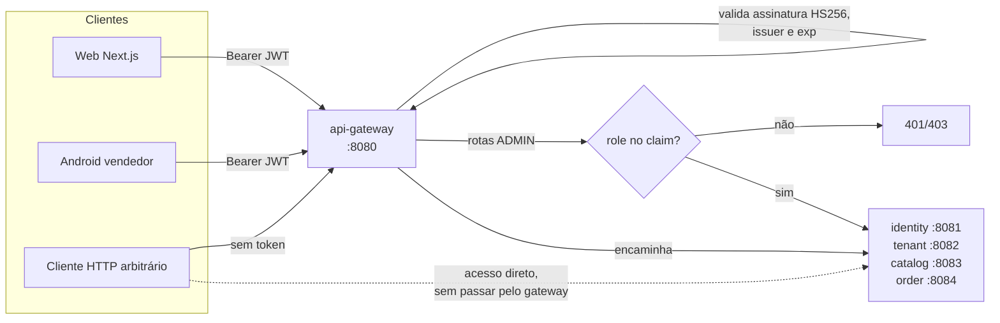

# 06 — Segurança

| Campo | Valor |
|---|---|
| Status | Autenticação implementada; autorização e isolamento multi-tenant parciais |
| Público | Engenharia, segurança, operações e revisores |
| Última revisão | 2026-10-26 |
| Escopo | Autenticação, autorização, sessão, segredos, CORS, LGPD e modelo de ameaças |
| Fonte de verdade | `SecurityConfiguration`, `JwtConfiguration`, `CorsConfiguration`, `AuthService`, `application.yml` e controllers |

> **Leia antes de expor o sistema.** Este documento descreve o modelo de segurança **real** do código atual. Vários endpoints de escrita estão abertos, os serviços de domínio não validam token e o `/api/store/**` resolve a loja pelo primeiro tenant ativo. Não trate este ambiente como pronto para internet sem executar a seção 11.

---

## 1. Modelo de segurança em uma página



| Controle | Onde está | Estado |
|---|---|---|
| Emissão de token | `identity-service` (`AuthService.generateToken`) | **Implementado** |
| Validação de token | `api-gateway` e `identity-service` (`JwtConfiguration`) | **Implementado** apenas nesses dois |
| Autorização por papel | `api-gateway` e `identity-service` (`SecurityConfiguration`) | **Parcial** — só rotas admin e mutações de tenant |
| Isolamento por loja | `tenant-service` / `order-service` / `catalog-service` | **Parcial** — resolve o primeiro tenant ativo |
| Revogação de sessão | — | **Planejado** |
| Refresh token | — | **Planejado** |
| Rate limiting | — | **Planejado** |
| Auditoria de segurança | `identity-service` (`audit`) | **Parcial** — registra ações administrativas, não acessos negados |

**Princípio real hoje:** o gateway é o único ponto de decisão de autorização. Os serviços de domínio confiam em qualquer requisição que chegue até eles. Quem alcançar `http://localhost:8082` diretamente ignora todas as regras do gateway.

---

## 2. Superfície de ataque

| Porta | Serviço | Proteção própria | Risco |
|---|---|---|---|
| `8080` | api-gateway | JWT + regras de rota | Ponto de entrada previsto |
| `8081` | identity-service | JWT + mesmas regras do gateway | Duplica a superfície; `/api/auth/login` exposto |
| `8082` | tenant-service | **Nenhuma** | CRUD de lojas, dados de proprietário e `/api/store/**` abertos |
| `8083` | catalog-service | **Nenhuma** | Escrita de cardápio aberta |
| `8084` | order-service | **Nenhuma** | Leitura de todos os pedidos e mudança de status abertas |
| `5432` | PostgreSQL | Senha padrão `postgrespassword` | Acesso direto a todos os bancos se a porta estiver publicada |
| `6379` | Redis | Não usado | Superfície sem função |
| `19092` | Redpanda | Sem autenticação nem TLS | Recebe `order-events` com dados do cliente; acesso direto ao broker expõe o stream |
| `8085` | Redpanda Console | Sem autenticação | Inspeção e publicação manual em tópicos |

### 2.1 Serviços sem `SecurityFilterChain`

Apenas `api-gateway` e `identity-service` possuem `SecurityConfiguration`. `tenant-service`, `catalog-service` e `order-service` não têm Spring Security no classpath. Consequências:

- Não há `401` nesses serviços; qualquer requisição é aceita.
- Cabeçalhos de identidade enviados pelo gateway (`Authorization`) são ignorados, não rejeitados.
- Em um deploy containerizado, se as portas `8082`–`8084` forem publicadas, o gateway deixa de ser barreira.

**Mitigação atual possível:** publicar apenas a porta `8080` e manter `8082`–`8084` em rede interna. Ver seção 11, item P0-1.

---

## 3. Autenticação

### 3.1 Emissão do token

Implementação em [`AuthService.generateToken`](../../backend/identity-service/src/main/java/com/delivery/identity/service/AuthService.java) e [`JwtConfiguration`](../../backend/identity-service/src/main/java/com/delivery/identity/config/JwtConfiguration.java).

| Item | Valor real |
|---|---|
| Algoritmo | HS256 (simétrico) |
| Biblioteca | Spring Security OAuth2 JOSE / Nimbus |
| Segredo | `JWT_SECRET`, mínimo de 32 bytes validado no startup |
| Emissor | `deliveryhub-identity` |
| TTL | 60 minutos (`spring.security.jwt.ttl-minutes`, padrão `60`) |
| Claims | `iss`, `iat`, `exp`, `sub` (UUID do usuário), `email`, `role` |
| Papéis | `ADMIN`, `SUPPORT`, `SELLER`, `COURIER`, `CUSTOMER` |

Payload decodificado:

```json
{
  "iss": "deliveryhub-identity",
  "iat": 1761500000,
  "exp": 1761503600,
  "sub": "3f1c9a52-8f0e-4a3d-9b1e-2c7d5e6f8a90",
  "email": "joao@pizzaria.com",
  "role": "SELLER"
}
```

O token **não** contém `tenantId`. Toda decisão de “qual loja” é feita no servidor — hoje de forma inadequada (seção 6.3).

### 3.2 Validação do token

O decoder é criado com `NimbusJwtDecoder.withSecretKey(...).macAlgorithm(HS256)` e valida:

- assinatura HMAC;
- `iss` igual ao emissor configurado;
- `exp` (validação padrão do `JwtValidators.createDefaultWithIssuer`);
- algoritmo esperado (evita confusão de algoritmo).

O claim `role` é convertido em autoridade `ROLE_<valor>` por `JwtGrantedAuthoritiesConverter` (`setAuthoritiesClaimName("role")`, `setAuthorityPrefix("ROLE_")`).

Pontos de atenção:

- Não há validação de `aud` (audiência). Um token emitido para outro sistema com o mesmo segredo seria aceito.
- O segredo é compartilhado entre gateway e identity. Comprometer um compromete ambos.
- Não há rotação de chave (`kid`).
- O token é válido até expirar; não há lista de revogação.

### 3.3 Senhas

| Aspecto | Implementação |
|---|---|
| Hash | BCrypt (`BCryptPasswordEncoder`, força padrão 10) |
| Migração de legado | Se a senha armazenada **não** começa com `$2`, ela é comparada em texto puro e regravada com BCrypt no primeiro login bem-sucedido |
| Política no cadastro público | Apenas `@NotBlank` — o cadastro público cria só `CUSTOMER`, sem tamanho mínimo |
| Política na gestão administrativa | Senha inicial e troca de senha exigem pelo menos 8 caracteres |
| Política no reset | `@Size(min = 8)` |
| Conta desativada | Login recusado com `403`; o token emitido antes da desativação continua válido até expirar |
| Bloqueio por tentativas | **Não existe** para login |
| Mensagem de erro | “Credenciais inválidas” (`401`) para usuário inexistente e senha errada |

O fallback de senha em texto puro em [`AuthService.passwordMatches`](../../backend/identity-service/src/main/java/com/delivery/identity/service/AuthService.java) existe para dados antigos. Ele significa que, se um registro legado nunca fizer login, a senha continua legível no banco. Verifique com:

```sql
SELECT id, email FROM users WHERE password NOT LIKE '$2%';
```

Se o resultado não for vazio, force reset dessas contas.

### 3.4 Login

`POST /api/auth/login` recebe `{ "email", "password" }`, normaliza o e-mail para minúsculas e sem espaços e retorna:

```json
{
  "token": "eyJhbGciOiJIUzI1NiJ9...",
  "tokenType": "Bearer",
  "user": { "id": "...", "name": "...", "email": "...", "role": "SELLER", "tenantId": "..." }
}
```

**Credenciais inválidas** retornam `401` com `{ "message": "Credenciais inválidas" }`. Contas com `active=false` retornam `403` com a mensagem de conta desativada. O corpo de erro é produzido por [`ApiExceptionHandler`](../../backend/identity-service/src/main/java/com/delivery/identity/config/ApiExceptionHandler.java), que também devolve as mensagens de validação em `errors[]`.

### 3.5 Registro público

`POST /api/auth/register`:

- aceita **apenas** `role = CUSTOMER`; qualquer outro perfil retorna `403`;
- ignora `tenantId` e grava `NULL` — o cliente é global;
- retorna um token já autenticado;
- não permite criar `ADMIN`, `SUPPORT`, `SELLER` nem `COURIER`.

Vendedor, entregador, analista de suporte e administrador são criados exclusivamente pelo painel administrativo, em `POST /api/auth/admin/users` (ADMIN). Isso remove a auto-atribuição indevida de `SELLER`.

Riscos remanescentes:

| Risco | Detalhe |
|---|---|
| `tenantId` não validado | O identity não consulta o tenant-service; ao criar um `SELLER`, o UUID escolhido no painel é aceito mesmo se a loja não existir. |
| Enumeração de e-mail | E-mail já cadastrado retorna `409` com “Email já cadastrado”. |
| Sem verificação de e-mail | Contas são criadas com e-mail não confirmado. |
| Sem CAPTCHA ou rate limit | Cadastro em massa de clientes é trivial. |

### 3.6 Gestão de usuários pelo painel

Endpoints administrativos (ADMIN):

| Método | Caminho | Efeito |
|---|---|---|
| `POST` | `/api/auth/admin/users` | Cria usuário com `role`, `tenantId`, senha inicial e situação. |
| `PUT` | `/api/auth/admin/users/{id}` | Edita dados, perfil, loja, situação e, opcionalmente, a senha. |
| `PATCH` | `/api/auth/admin/users/{id}/status` | Ativa ou desativa a conta. |

Regras aplicadas no serviço:

- `ADMIN` e `SUPPORT` são contas da plataforma e não podem ter `tenantId`;
- `SELLER` exige `tenantId`;
- `COURIER` e `CUSTOMER` podem ter ou não loja;
- e-mail é único;
- senha inicial e troca de senha exigem 8 caracteres;
- a última conta `ADMIN` ativa não pode ser desativada nem rebaixada;
- um administrador não pode remover o próprio acesso de administrador.

Analistas de suporte podem consultar `GET /api/auth/users` para resolver nomes de entregadores em pedidos, mas não podem criar, editar ou desativar usuários, nem acessar `/api/auth/admin/**`.

### 3.7 Recuperação de senha por SMS

Fluxo detalhado em [`../redefinicao-senha-sms.md`](../redefinicao-senha-sms.md). Resumo de segurança:

| Controle | Valor |
|---|---|
| Escopo | Apenas contas `ADMIN` — vendedores, entregadores e clientes não podem redefinir |
| Código | 8 dígitos gerados com `SecureRandom` |
| Armazenamento | HMAC-SHA256 do código com `JWT_SECRET` como pepper — o código em claro não é persistido |
| Validade | 10 minutos |
| Tentativas | 5 (`attemptsRemaining`), depois o token é apagado |
| Reenvio | Bloqueado por 60 segundos |
| Enumeração | Resposta idêntica exista ou não a conta |
| Transporte | Twilio; se não configurado, `503` explícito |
| Falha de envio | Token é apagado e retorna `503` |

Pontos de atenção:

- O mesmo segredo assina JWT e protege códigos de reset. Rotacionar `JWT_SECRET` invalida tokens **e** códigos pendentes.
- Não há limite global por IP; o limite é por conta.
- O código trafega por SMS (canal fora do controle da aplicação).

### 3.8 Sessão, logout e expiração

| Item | Web | Android |
|---|---|---|
| Armazenamento | `localStorage` (`deliveryhub.admin.session`, `deliveryhub.seller.session`) | `EncryptedSharedPreferences` (AES256-GCM, chave em `MasterKey`) |
| Envio | `Authorization` apenas no cliente admin (`adminApi.ts`); o cliente do vendedor **não envia** | Interceptor OkHttp anexa o token |
| Expiração | Validada no cliente lendo `exp` do payload | Sem validação local; o backend decide |
| Logout | Remove a chave do `localStorage` | `SessionStore.clear()` |
| Revogação | **Não existe** | **Não existe** |

Um token copiado continua válido até o `exp`, mesmo após logout. Em caso de incidente, a única contenção é trocar `JWT_SECRET` (invalida **todos** os usuários) ou aguardar 60 minutos.

---

## 4. Autorização

### 4.1 Regras do gateway

[`SecurityConfiguration`](../../backend/api-gateway/src/main/java/com/delivery/gateway/config/SecurityConfiguration.java):

```java
.requestMatchers(HttpMethod.OPTIONS, "/**").permitAll()
.requestMatchers("/swagger-ui.html", "/swagger-ui/**", "/v3/api-docs/**").permitAll()
.requestMatchers("/api/auth/login", "/api/auth/register",
                 "/api/auth/password/forgot", "/api/auth/password/reset",
                 "/actuator/health").permitAll()
.requestMatchers("/api/auth/admin/**").hasRole("ADMIN")
.requestMatchers(HttpMethod.GET, "/api/auth/users", "/api/auth/users/**").hasAnyRole("ADMIN", "SUPPORT")
.requestMatchers("/api/auth/users", "/api/auth/users/**").hasRole("ADMIN")
.requestMatchers(HttpMethod.POST, "/api/tenants").hasRole("ADMIN")
.requestMatchers(HttpMethod.PUT, "/api/tenants/**").hasRole("ADMIN")
.requestMatchers(HttpMethod.PATCH, "/api/tenants/**").hasRole("ADMIN")
.anyRequest().permitAll()
```

A cláusula `anyRequest().permitAll()` é a decisão mais importante deste arquivo: **tudo o que não foi listado é público**. Novos endpoints nascem públicos por padrão.

### 4.2 Matriz de autorização por endpoint

Legenda: **Público** = sem token; **ADMIN** = token com `role=ADMIN`; **SUPPORT** = token com `role=SUPPORT` (somente leitura de usuários); **Nenhuma** = serviço não valida nada (mesmo que o gateway valide).

#### Identity (`:8081`, via gateway em `/api/auth/**`)

| Método | Caminho | Gateway | Serviço | Efetivo |
|---|---|---|---|---|
| POST | `/api/auth/login` | Público | Público | Público |
| POST | `/api/auth/register` | Público | Público (só CUSTOMER) | Público |
| POST | `/api/auth/password/forgot` | Público | Público | Público |
| POST | `/api/auth/password/reset` | Público | Público | Público |
| GET | `/api/auth/users` | ADMIN ou SUPPORT | ADMIN ou SUPPORT | **ADMIN/SUPPORT** |
| GET | `/api/auth/users/{id}` | ADMIN ou SUPPORT | ADMIN ou SUPPORT | **ADMIN/SUPPORT** |
| PUT | `/api/auth/users/{id}` | ADMIN | ADMIN | **ADMIN** |
| POST | `/api/auth/admin/team` | ADMIN | ADMIN | **ADMIN** |
| POST | `/api/auth/admin/users` | ADMIN | ADMIN | **ADMIN** |
| PUT | `/api/auth/admin/users/{id}` | ADMIN | ADMIN | **ADMIN** |
| PATCH | `/api/auth/admin/users/{id}/status` | ADMIN | ADMIN | **ADMIN** |
| POST | `/api/auth/admin/users/{id}/seller-link` | ADMIN | ADMIN | **ADMIN** |
| GET/PUT | `/api/auth/admin/settings` | ADMIN | ADMIN | **ADMIN** |
| GET/POST | `/api/auth/admin/audit` | ADMIN | ADMIN | **ADMIN** |

#### Tenant (`:8082`)

| Método | Caminho | Gateway | Serviço | Efetivo |
|---|---|---|---|---|
| GET | `/api/tenants` | Público | Nenhuma | **Público** |
| GET | `/api/tenants/{slug}` | Público | Nenhuma | **Público** |
| GET | `/api/tenants/id/{id}` | Público | Nenhuma | **Público** |
| GET | `/api/tenants/{slug}/theme` | Público | Nenhuma | **Público** |
| POST | `/api/tenants` | ADMIN | Nenhuma | ADMIN via gateway; **público** na porta 8082 |
| PUT | `/api/tenants/{id}` | ADMIN | Nenhuma | ADMIN via gateway; **público** na porta 8082 |
| PATCH | `/api/tenants/{id}/status` | ADMIN | Nenhuma | ADMIN via gateway; **público** na porta 8082 |
| GET | `/api/store/me` | Público | Nenhuma | **Público** |
| GET/PUT | `/api/store/me/payments` | Público | Nenhuma | **Público** |
| POST | `/api/store/me/payments/proposals/pending/{confirm,reject}` | Público | Nenhuma | **Público** |
| GET | `/api/store/me/couriers` | Público | Nenhuma | **Público** |

#### Catalog (`:8083`)

| Método | Caminho | Gateway | Serviço | Efetivo |
|---|---|---|---|---|
| GET | `/api/catalog/tenants/{tenantId}/dishes` | Público | Nenhuma | **Público** |
| GET | `/api/catalog/tenants/{tenantId}/categories` | Público | Nenhuma | **Público** |
| GET | `/api/catalog/dishes/{id}` | Público | Nenhuma | **Público** |
| POST | `/api/catalog/dishes` | Público | Nenhuma | **Público (escrita)** |
| PUT | `/api/catalog/dishes/{id}` | Público | Nenhuma | **Público (escrita)** |
| PATCH | `/api/catalog/dishes/{id}` | Público | Nenhuma | **Público (escrita)** |
| PATCH | `/api/catalog/dishes/{id}/availability` | Público | Nenhuma | **Público (escrita)** |
| GET/POST | `/api/store/me/dishes` | Público | Nenhuma | **Público (escrita)** |
| PUT | `/api/store/me/dishes/{id}` | Público | Nenhuma | **Público (escrita)** |
| PUT | `/api/store/me/dishes/{id}/toggle` | Público | Nenhuma | **Público (escrita)** |

#### Order (`:8084`)

| Método | Caminho | Gateway | Serviço | Efetivo |
|---|---|---|---|---|
| POST | `/api/orders` | Público | Nenhuma | **Público** |
| POST | `/api/orders/availability` | Público | Nenhuma | **Público (leitura de agenda)** |
| GET | `/api/orders` | Público | Nenhuma | **Público — todos os pedidos** |
| GET | `/api/orders/{id}` | Público | Nenhuma | **Público** |
| GET | `/api/orders/tenant/{tenantId}` | Público | Nenhuma | **Público** |
| GET | `/api/orders/tenant/{tenantId}/agenda` | Público | Nenhuma | **Público — agenda sanitizada (web do cliente e app vendedor)** |
| GET | `/api/orders/courier/{courierId}` | Público | Nenhuma | **Público** |
| GET | `/api/orders/available-deliveries` | Público | Nenhuma | **Público** |
| PATCH | `/api/orders/{id}/status` | Público | Nenhuma | **Público (escrita)** |
| GET/POST | `/api/store/me/orders/**` | Público | Nenhuma | **Público (escrita)** |

### 4.3 Lacunas de autorização

Ordenadas por impacto. Cada uma é reproduzível no ambiente local.

#### L1 — Escrita de catálogo sem autenticação (Crítica)

`POST /api/catalog/dishes`, `PUT /api/catalog/dishes/{id}` e os endpoints `/api/store/me/dishes/**` não exigem token em nenhuma camada.

```powershell
# Sem token algum: cria um prato
Invoke-RestMethod -Method Post -Uri http://localhost:8080/api/catalog/dishes `
  -ContentType 'application/json' `
  -Body '{"tenantId":"11111111-1111-1111-1111-111111111111","name":"Prato invasor","price":0.01}'
```

Impacto: adulteração de preço, cardápio e disponibilidade de qualquer loja.

#### L2 — Mudança de status de pedido sem autenticação (Crítica)

`PATCH /api/orders/{id}/status` aceita qualquer status e qualquer `courierId`. Não valida transição, loja ou entregador.

```powershell
Invoke-RestMethod -Method Patch -Uri http://localhost:8080/api/orders/<uuid>/status `
  -ContentType 'application/json' -Body '{"status":"DELIVERED"}'
```

Impacto: pedido marcado como entregue sem entrega; pedido cancelado por terceiros; atribuição de entregador arbitrária.

Além do problema de autorização, valores inválidos derrubam a requisição: `status` desconhecido causa `IllegalArgumentException` → `500`; `courierId` não-UUID (ex.: `courier-carlos-1`, enviado pela tela do entregador) → `500`.

#### L3 — `/api/store/**` resolve o primeiro tenant ativo (Crítica)

`StoreController.currentTenant()` e `TenantLookup.resolve()` pegam `getAllActive().get(0)`. O `JwtAuthenticationConverter` não injeta `tenantId` e nenhum controller lê a identidade.

Consequências:

- Um vendedor autenticado da loja B opera sobre a loja A se ela vier primeiro na ordenação.
- Mesmo sem token, qualquer chamada a `/api/store/me/*` acessa a primeira loja.
- `GET /api/orders` lista pedidos de todas as lojas.
- `POST /api/store/me/orders/counter` aceita `tenantId` arbitrário no corpo.

Impacto: vazamento entre tenants e escrita cruzada — a falha mais grave para um marketplace multi-tenant.

#### L4 — Cliente do vendedor no web não envia `Authorization` (Alta)

Apenas [`adminApi.ts`](../../frontend/src/lib/adminApi.ts) anexa o token. As páginas de vendedor usam `fetch`/`apiRequest` sem `Authorization`. Elas funcionam **porque** os endpoints são públicos.

Impacto: mesmo que a autorização do backend seja corrigida, o portal do vendedor para de funcionar até o cliente ser atualizado. A correção precisa ser coordenada.

#### L5 — Serviços de domínio ignoram identidade (Alta)

`tenant-service`, `catalog-service` e `order-service` não têm Spring Security. A única barreira é a rede. Qualquer processo no host acessa `:8082`, `:8083` e `:8084` sem token.

#### L6 — Dados de loja e proprietário expostos publicamente (Alta)

`GET /api/tenants` e `GET /api/tenants/{slug}` retornam a entidade `Tenant` completa, incluindo `document`, `legalName`, `ownerName`, `ownerEmail`, `ownerPhone`, `phone`, `address`, `city` e `state`.

Parte desses campos é necessária para a vitrine (nome, tema, taxa). Documento e contato do proprietário não são. O parâmetro `?all=true` também permite listar lojas inativas sem autenticação.

#### L7 — Listagem global de pedidos (Alta)

`GET /api/orders` retorna todos os pedidos, com nome, telefone, endereço e itens dos clientes. Não há paginação nem filtro por loja. É um dump de PII acessível sem token.

#### L8 — Token sem `tenantId` e sem `aud` (Média)

A ausência de `tenantId` no token força o servidor a inferir a loja — e a inferência atual é incorreta. A ausência de `aud` permite reutilizar tokens entre audiências que compartilhem o segredo.

#### L9 — Sem proteção contra força bruta e enumeração (Média)

Não há rate limit no login, no registro, no reset ou no gateway. O reset mitiga enumeração pela mensagem, mas o login responde mais rápido para e-mail inexistente do que para senha errada (o primeiro não executa BCrypt), permitindo *timing attack*.

#### L10 — Swagger público (Baixa/Média)

`/swagger-ui.html`, `/swagger-ui/**` e `/v3/api-docs/**` são públicos no gateway e nos serviços. Em produção, isso expõe o mapa completo da API.

#### L11 — Agenda pública sem autenticação (Média)

`GET /api/orders/tenant/{tenantId}/agenda` não exige token e aceita qualquer `tenantId`. O payload é sanitizado (sem nome, telefone, endereço ou valores), mas expõe número do pedido, status, itens, horários e esforço. Isso permite enumerar o movimento da loja e inferir preferências; combinado com L7, o número do pedido pode ser correlacionado a PII em `GET /api/orders`.

Mitigação recomendada: exigir sessão de cliente ou link assinado com escopo por loja e aplicar rate limit por IP/tenant.

---

## 5. CORS

Configuração em [`CorsConfiguration`](../../backend/api-gateway/src/main/java/com/delivery/gateway/config/CorsConfiguration.java):

| Item | Valor |
|---|---|
| Escopo | `/api/**` |
| Origens padrão | `http://localhost:*`, `http://127.0.0.1:*`, `http://192.168.*:*`, `http://10.*:*`, `http://172.16.*:*` |
| Métodos | `GET, POST, PUT, PATCH, DELETE, OPTIONS` |
| Cabeçalhos | `*` |
| Credenciais | `allowCredentials(true)` |
| Preflight | Cache de 3600 s |
| Sobrescrita | `security.cors.allowed-origin-patterns` |

Análise:

- `allowCredentials(true)` com padrões amplos é aceitável apenas porque a autenticação é por header `Authorization`, não por cookie. Se cookies forem adotados, a combinação passa a ser perigosa.
- Os padrões incluem **toda** a faixa `10.*` e `192.168.*`, o que abrange redes corporativas inteiras, não apenas a máquina de desenvolvimento.
- CORS é aplicado **somente no gateway**. Chamadas diretas a `:8082`–`:8084` não recebem cabeçalhos CORS (e, portanto, são bloqueadas pelo navegador — mas continuam acessíveis por ferramentas).
- Não há configuração de CORS em `identity-service`, embora ele também exponha `/api/auth/**` diretamente. O navegador só consegue usá-lo via gateway.

Recomendação: em produção, definir `security.cors.allowed-origin-patterns` com os domínios exatos e remover os padrões de rede privada.

---

## 6. Gestão de segredos

| Segredo | Onde | Padrão no código | Risco |
|---|---|---|---|
| `JWT_SECRET` | gateway e identity | `deliveryhub-local-only-secret-key-change-before-deploy-2026` | **Alto** — valor público no repositório; qualquer um forja tokens |
| Senha do PostgreSQL | todos os serviços | `postgrespassword` | **Alto** em rede exposta |
| Twilio Account SID / Auth Token / From | identity | vazios | Médio — reset fica indisponível |
| `ADMIN_PHONE` | identity | vazio | Baixo |
| Senhas de demonstração | seeders | `admin123`, `loja123`, `entrega123`, `cliente123` | **Alto** se o seed for habilitado fora de dev |

Boas práticas já presentes:

- Segredos vêm de variáveis de ambiente com *fallback* apenas para desenvolvimento.
- O startup falha se `JWT_SECRET` tiver menos de 32 bytes.
- Não há `.env` versionado no repositório.

Lacunas:

- Não há cofre (Vault, AWS Secrets Manager, Azure Key Vault) nem injeção por orquestrador.
- O fallback do `JWT_SECRET` é funcional e silencioso: sem a variável, o sistema sobe com um segredo conhecido. Em produção, o startup deveria **falhar**.
- O mesmo segredo protege JWT e códigos de reset (seção 3.6).

Verificação de que o segredo padrão está em uso:

```powershell
# Deve retornar um valor. Se estiver vazio, o serviço está usando o fallback do application.yml.
Get-ChildItem Env:JWT_SECRET

# Confirma o valor default no código
Select-String -Path backend\*\src\main\resources\application.yml -Pattern 'JWT_SECRET'
```

> Se a variável não estiver definida, o gateway e o identity sobem com o segredo público do repositório. Não gere tokens manualmente para testar em ambientes compartilhados; trate a ausência da variável como incidente.

---

## 7. Dados pessoais e LGPD

### 7.1 Dados tratados

| Categoria | Campos | Onde |
|---|---|---|
| Identificação | nome, e-mail, telefone | `identity_db.users` |
| Credencial | hash BCrypt (e possíveis legados em texto puro) | `identity_db.users` |
| Endereço | rua, número, complemento, bairro, cidade, CEP | `order_db.orders` |
| Contato do cliente | nome e telefone no pedido | `order_db.orders` |
| Dados da loja | razão social, CNPJ, endereço, telefone | `tenant_db.tenants` |
| Dados do proprietário | nome, e-mail, telefone | `tenant_db.tenants` |
| Auditoria | ator, ação, detalhe | `identity_db` (auditoria administrativa) |
| Eventos de pedido | payload com nome, telefone, endereço e itens | Tópico `order-events` no Redpanda |

### 7.2 Bases legais e finalidade

O código **não** registra consentimento, finalidade, base legal nem prazo de retenção. Para operar em conformidade com a LGPD (Lei 13.709/2018), é necessário definir:

| Tratamento | Base legal provável | Observação |
|---|---|---|
| Cadastro e autenticação | Execução de contrato (art. 7º, V) | Necessário para prestar o serviço |
| Endereço e telefone do pedido | Execução de contrato | Usado para entrega e contato |
| Auditoria administrativa | Obrigação legal / legítimo interesse | Definir prazo |
| Comunicação de marketing | Consentimento | **Não implementado** |

### 7.3 Lacunas de conformidade

| Lacuna | Impacto |
|---|---|
| Sem política de retenção ou expurgo | Pedidos e dados pessoais ficam indefinidamente |
| Sem direito de exclusão/anonimização | Não há endpoint para atender titular |
| Sem exportação de dados do titular | Idem |
| Sem registro de consentimento | Difícil comprovar base legal |
| Sem criptografia em repouso além do disco | Depende da infraestrutura |
| PII em logs | `org.hibernate.type.descriptor.sql.BasicBinder: TRACE` em `application.yml` registra parâmetros SQL, incluindo e-mails e telefones |
| Enumeração de e-mail no cadastro | `409` revela contas existentes |

O `TRACE` de bind parameters é especialmente relevante: ele existe nos `application.yml` de identity, order e gateway (herdado do template) e deve ser removido fora de desenvolvimento. Em identity, isso pode registrar e-mails e telefones; nenhum log registra a senha em claro (o bind é do hash), mas o volume de PII é alto.

---

## 8. Modelo de ameaças (STRIDE)

| Ameaça | Cenário concreto | Controles atuais | Risco |
|---|---|---|---|
| **Spoofing** | Forjar JWT com o segredo padrão do repositório e agir como `ADMIN` | Segredo padrão conhecido; sem rotação | **Crítico** |
| **Spoofing** | Registrar-se como `SELLER` de outra loja via `tenantId` livre | Cadastro público restrito a `CUSTOMER`; demais perfis só pelo painel | **Baixo** |
| **Spoofing** | Token de conta desativada continua válido por até 60 minutos | `active` só é checado no login; sem revogação | **Médio** |
| **Tampering** | Alterar preço de prato via `POST /api/catalog/dishes` sem token | Nenhum | **Crítico** |
| **Tampering** | Marcar pedido como entregue via `PATCH /api/orders/{id}/status` | Nenhum | **Crítico** |
| **Repudiation** | Negar ação administrativa | Auditoria administrativa existe, mas não cobre catálogo/pedidos | **Médio** |
| **Information disclosure** | `GET /api/orders` sem token expõe PII de todos os clientes | Nenhum | **Crítico** |
| **Information disclosure** | `GET /api/orders/tenant/{tenantId}/agenda` expõe movimento, itens e horários da loja | Payload sanitizado; endpoint público | **Médio** |
| **Information disclosure** | Tópico `order-events` sem autenticação contém nome, telefone e endereço do cliente | Broker sem SASL/TLS; console aberto | **Alto** |
| **Information disclosure** | `GET /api/tenants` expõe CNPJ e contato do proprietário | Nenhum | **Alto** |
| **Denial of service** | `GET /api/orders` sem paginação; login sem rate limit | Nenhum | **Alto** |
| **Elevation of privilege** | Acessar `:8082`–`:8084` direto e ignorar o gateway | Serviços sem autenticação | **Crítico** |
| **Elevation of privilege** | `SELLER` opera em loja diferente da sua | Resolução pelo primeiro tenant | **Crítico** |
| **XSS → roubo de token** | Script injetado lê `localStorage` e exfiltra o JWT | Token em `localStorage`, sem cookie `HttpOnly` | **Alto** |
| **CSRF** | — | Não aplicável enquanto o token for header e não cookie | Baixo hoje |
| **Supply chain** | Dependência comprometida | Sem SBOM, sem Dependabot, sem lockfile de Maven | **Médio** |

### 8.1 Cenário de ataque encadeado

1. Atacante lê o `JWT_SECRET` padrão no `application.yml` do gateway.
2. Forja um token `ADMIN` para qualquer `sub`.
3. Chama `GET /api/auth/users` e obtém a base de usuários.
4. Chama `GET /api/orders` e obtém pedidos com endereço e telefone.
5. Altera preços no catálogo e marca pedidos como entregues.

Nenhum passo exige credencial legítima. Esse é o motivo de o item P0-1 do checklist ser “definir segredo forte e não publicar portas de domínio”.

---

## 9. Auditoria e monitoramento

| Evento | Registrado? | Onde |
|---|---|---|
| Login bem-sucedido | Não | — |
| Login falho | Não | — |
| Criação/edição de usuário | Sim | `identity` — auditoria administrativa |
| Criação/edição de loja | Parcial | Auditoria administrativa via frontend, não no serviço |
| Escrita de catálogo | Não | — |
| Mudança de status de pedido | Não | — |
| Acesso negado (403) | Não | — |
| Erro 500 | Log de aplicação | stdout |

Não há correlação de requisição (`traceId`), métricas de segurança, alertas ou retenção definida para logs.

---

## 10. Requisitos de segurança para evolução

| Requisito | Estado | Prioridade |
|---|---|---|
| `JWT_SECRET` obrigatório e forte, sem fallback em produção | **Divergente** | P0 |
| Autorização de escrita em catálogo e pedidos | **Planejado** | P0 |
| Isolamento por tenant derivado do token | **Planejado** | P0 |
| Serviços de domínio com validação de token (resource server) | **Planejado** | P0 |
| Rate limit em login, registro e reset | **Planejado** | P1 |
| `401` correto para credenciais inválidas | **Divergente** | P1 |
| Política de senha (mínimo 8, sem senhas comuns) no cadastro | **Planejado** | P1 |
| Swagger desabilitado em produção | **Planejado** | P1 |
| Rotação de segredo e `kid` | **Planejado** | P2 |
| Refresh token e revogação | **Planejado** | P2 |
| `aud` no token | **Planejado** | P2 |
| MFA para `ADMIN` | **Planejado** | P2 |
| Criptografia de PII em repouso | **Planejado** | P2 |
| Retenção e anonimização (LGPD) | **Planejado** | P1 |

---

## 11. Checklist de hardening priorizado

### P0 — antes de qualquer exposição externa

- [ ] Definir `JWT_SECRET` forte (≥ 32 bytes aleatórios) em todos os ambientes e **remover** o valor padrão do `application.yml`.
- [ ] Publicar apenas a porta `8080`; manter `8082`–`8084` e `5432` em rede interna.
- [ ] Restringir escrita de catálogo a `SELLER`/`ADMIN` com vínculo ao tenant.
- [ ] Restringir `PATCH /api/orders/{id}/status` ao dono do pedido ou ao entregador atribuído.
- [ ] Derivar o tenant do token (adicionar `tenantId` ao JWT) e remover `getAllActive().get(0)`.
- [ ] Remover `GET /api/orders` sem escopo ou protegê-lo com `ADMIN`.
- [ ] Reduzir o payload público de `/api/tenants` a campos de vitrine (nome, slug, tema, taxa).
- [ ] Trocar o fallback de senha em texto puro por migração forçada.

### P1 — antes de produção

- [ ] Adicionar Spring Security como resource server em tenant, catalog e order.
- [ ] Implementar rate limit no gateway (login, registro, reset).
- [ ] Retornar `401` com `WWW-Authenticate` em credenciais inválidas.
- [ ] Aplicar política de senha no cadastro (mínimo 8, bloqueio de senhas comuns).
- [ ] Fazer o cliente do vendedor enviar `Authorization`.
- [ ] Desabilitar Swagger e Actuator detalhado em produção.
- [ ] Remover `BasicBinder: TRACE` e `org.springframework.web: DEBUG` dos perfis não-locais.
- [ ] Restringir o Redpanda: rede interna, SASL/TLS e console desabilitado fora de dev.
- [ ] Definir retenção do tópico `order-events` compatível com a política de dados.
- [ ] Definir retenção e rotina de expurgo de pedidos e dados pessoais.
- [ ] Restringir CORS aos domínios reais.

### P2 — maturidade

- [ ] Adicionar `aud` ao token e validar no gateway.
- [ ] Implementar refresh token com rotação e revogação.
- [ ] Introduzir `kid` e rotação de chaves.
- [ ] MFA para contas `ADMIN`.
- [ ] Auditoria de leitura de PII e de acessos negados.
- [ ] SBOM e varredura de dependências no CI.
- [ ] Testes de autorização automatizados por papel e por tenant.

---

## 12. Como verificar o estado atual

Execute com o ambiente local no ar. Os comandos abaixo **não** alteram dados quando usam `GET`; os de escrita estão marcados.

```powershell
# 1. Endpoint administrativo sem token deve retornar 401/403
try { Invoke-WebRequest http://localhost:8080/api/auth/users } catch { $_.Exception.Response.StatusCode.value__ }

# 2. Serviço de domínio responde sem token (prova de L5)
(Invoke-WebRequest http://localhost:8082/api/tenants).StatusCode

# 3. Listagem global de pedidos sem token (prova de L7)
(Invoke-RestMethod http://localhost:8080/api/orders).Count

# 4. Payload público da loja (prova de L6) — observe document/ownerEmail
Invoke-RestMethod http://localhost:8080/api/tenants/pizzaria-do-joao |
  Select-Object name, document, ownerEmail, ownerPhone

# 5. Escrita sem token (prova de L1) — ALTERA DADOS
# Invoke-RestMethod -Method Post -Uri http://localhost:8080/api/catalog/dishes `
#   -ContentType 'application/json' `
#   -Body '{"tenantId":"11111111-1111-1111-1111-111111111111","name":"teste","price":1}'
```

Resultado esperado hoje: itens 2, 3 e 4 retornam `200` sem credencial. Isso confirma as lacunas descritas. Após o hardening P0, devem retornar `401`/`403` ou payload reduzido.

---

## 13. Referências

| Tema | Fonte |
|---|---|
| Autenticação OAuth2/JWT | [RFC 7519 — JSON Web Token](https://www.rfc-editor.org/rfc/rfc7519) |
| Boas práticas JWT | [RFC 8725 — JWT Best Current Practices](https://www.rfc-editor.org/rfc/rfc8725) |
| OAuth 2.0 Security BCP | [RFC 9700](https://www.rfc-editor.org/rfc/rfc9700) |
| Senhas | [OWASP Password Storage Cheat Sheet](https://cheatsheetseries.owasp.org/cheatsheets/Password_Storage_Cheat_Sheet.html) |
| Autorização | [OWASP Authorization Cheat Sheet](https://cheatsheetseries.owasp.org/cheatsheets/Authorization_Cheat_Sheet.html) |
| Modelo de ameaças | [OWASP Threat Modeling](https://owasp.org/www-community/Threat_Modeling) |
| CORS | [MDN — CORS](https://developer.mozilla.org/docs/Web/HTTP/CORS) |
| Segurança em APIs | [OWASP API Security Top 10](https://owasp.org/API-Security/editions/2023/en/0x00-header/) |
| LGPD | [Lei 13.709/2018](https://www.planalto.gov.br/ccivil_03/_ato2015-2018/2018/lei/l13709.htm) |
| Gestão de segredos | [OWASP Secrets Management Cheat Sheet](https://cheatsheetseries.owasp.org/cheatsheets/Secrets_Management_Cheat_Sheet.html) |

---

## 14. Documentos relacionados

- [`02-arquitetura.md`](02-arquitetura.md) — fronteiras de confiança e fluxos
- [`03-api.md`](03-api.md) — contratos e lacunas de API
- [`04-dados.md`](04-dados.md) — onde a PII está armazenada
- [`05-operacao.md`](05-operacao.md) — configuração de `JWT_SECRET` e Twilio
- [`07-qualidade-e-testes.md`](07-qualidade-e-testes.md) — testes de autorização recomendados
- [`09-decisoes/0003-jwt-hs256-no-gateway-e-identity.md`](09-decisoes/0003-jwt-hs256-no-gateway-e-identity.md) — decisão de autenticação
