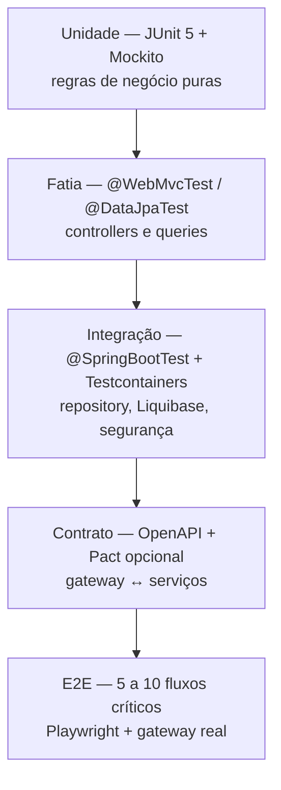
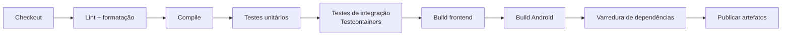

# 07 — Qualidade e testes

| Campo | Valor |
|---|---|
| Status | Verificação automatizada mínima; sem CI versionado |
| Público | Engenharia, QA, produto e revisores |
| Última revisão | 2026-10-28 |
| Escopo | Inventário de testes, estratégia, cenários, portões de CI e critérios de aceite |
| Fonte de verdade | `src/test`, `package.json`, `build.gradle.kts` e código de produção |

> **Resumo honesto:** existem cinco testes de contexto no backend, um por serviço. Não há teste de comportamento, de contrato, de frontend, de Android ou de integração. Também não há pipeline. A qualidade atual é sustentada por verificação manual e por `npm run build`/`lint`.

---

## 1. Estado atual em uma página

| Camada | Testes | Como rodar | Dependência externa |
|---|---|---|---|
| Backend — unidade | Nenhum | — | — |
| Backend — fatia (`@WebMvcTest`) | Nenhum | — | — |
| Backend — integração | 5 × `contextLoads()` | `.\mvnw.cmd test` | PostgreSQL local no ar |
| Backend — contrato | Nenhum | — | — |
| Backend — E2E | Nenhum | — | — |
| Frontend — unidade | Nenhum | — | — |
| Frontend — componente | Nenhum | — | — |
| Frontend — E2E | Nenhum | — | — |
| Frontend — estático | ESLint + build de produção | `npm run lint`, `npm run build` | — |
| Android — unidade | Nenhum | — | — |
| Android — instrumentado | Nenhum | — | — |
| Android — build | Compilação | `gradlew assembleDebug`, `gradlew :app:compileDebugKotlin` | SDK Android |
| CI/CD | Nenhum workflow versionado | — | — |

### 1.1 Os cinco testes existentes

| Serviço | Arquivo | Conteúdo |
|---|---|---|
| api-gateway | [`ApiGatewayApplicationTests.java`](../../backend/api-gateway/src/test/java/com/delivery/gateway/ApiGatewayApplicationTests.java) | `contextLoads()` |
| identity-service | [`IdentityServiceApplicationTests.java`](../../backend/identity-service/src/test/java/com/delivery/identity/IdentityServiceApplicationTests.java) | `contextLoads()` |
| tenant-service | [`TenantServiceApplicationTests.java`](../../backend/tenant-service/src/test/java/com/delivery/tenant/TenantServiceApplicationTests.java) | `contextLoads()` |
| catalog-service | [`CatalogServiceApplicationTests.java`](../../backend/catalog-service/src/test/java/com/delivery/catalog/CatalogServiceApplicationTests.java) | `contextLoads()` |
| order-service | [`OrderServiceApplicationTests.java`](../../backend/order-service/src/test/java/com/delivery/order/OrderServiceApplicationTests.java) | `contextLoads()` |

O que eles garantem: o contexto Spring sobe, os beans resolvem, o Liquibase aplica e o mapeamento JPA valida contra o schema. É uma verificação de *wiring*, não de comportamento.

O que eles **não** garantem: nenhum endpoint, regra de negócio, transição de status, cálculo de taxa, contrato JSON, autorização ou isolamento entre lojas.

### 1.2 Verificação manual registrada

A gestão de usuários foi validada manualmente contra o `identity-service` (`:8081`) em 2026-10-26, sem teste automatizado correspondente:

| Cenário | Resultado observado |
|---|---|
| Criar `CUSTOMER`, `COURIER`, `SELLER`, `SUPPORT` e `ADMIN` pelo painel | `200` com `role`, `tenantId` e `active` corretos |
| `SELLER` sem loja / `SUPPORT` com loja | `400` com mensagem legível |
| E-mail duplicado | `409` |
| Cadastro público como `SELLER` | `403` |
| Cadastro público como `CUSTOMER` | `200`, `tenantId = null` |
| `SUPPORT` consulta `/api/auth/users` | `200` |
| `CUSTOMER` consulta `/api/auth/users` | `403` |
| `COURIER` editado para `SUPPORT` com nova senha | `200`; login novo `200`, senha antiga `401` |
| Desativar cliente e tentar login | `403`; reativar → `200` |
| Admin desativar/rebaixar a própria conta | `409` |
| Login inválido / perfil inválido / senha curta | `401` / `400` / `400` com `message` e `errors[]` |

O resultado é evidência de comportamento, não cobertura: qualquer regressão nessas regras só será detectada por novo teste manual até que R1 e R12–R17 existam em código.

### 1.3 Por que os testes dependem do PostgreSQL

Não existe `application-test.yml`, `@ActiveProfiles("test")` ou `@TestPropertySource` em nenhum módulo. O `@SpringBootTest` sobe com o perfil `default` (`local`) e usa a URL padrão:

```yaml
url: ${SPRING_DATASOURCE_URL:jdbc:postgresql://localhost:5432/identity_db}
```

Como `ddl-auto: validate` e o Liquibase estão ativos, o teste precisa de um PostgreSQL acessível com o banco correspondente. Consequências:

- `mvn test` falha em uma máquina limpa sem `docker compose up -d`.
- O teste não roda em pipeline sem serviço de banco.
- O H2 está no classpath (`runtime`) de identity, tenant, catalog e order, mas **não é usado** por nenhum perfil de teste.

O `contextLoads()` do gateway não usa banco, mas valida o segredo JWT: com `JWT_SECRET` menor que 32 bytes, o contexto falha.

### 1.4 Comandos reais

```powershell
# Backend — sempre por serviço, a partir do diretório dele (exige PostgreSQL no ar)
cd backend\identity-service
.\mvnw.cmd test

# Apenas compilação
.\mvnw.cmd test-compile -DskipTests

# Frontend
cd frontend
npm run lint
npm run build

# Android
cd mobile\vendedor-android
.\gradlew.bat assembleDebug

cd ..\cliente-android
.\gradlew.bat assembleDebug
```

> Não existe mais agregador em `backend/`: cada serviço tem o próprio `pom.xml` e o próprio Maven Wrapper, então testes e builds rodam por repositório.

---

## 2. Estratégia de testes alvo

A estratégia segue a pirâmide clássica adaptada a microsserviços: muitas unidades rápidas, poucas fatias de integração e um conjunto enxuto de E2E. O objetivo é cobrir os riscos reais listados em [`02-arquitetura.md`](02-arquitetura.md) e [`06-seguranca.md`](06-seguranca.md), não perseguir percentual.



| Nível | Ferramenta recomendada | Escopo | Meta |
|---|---|---|---|
| Unidade | JUnit 5, AssertJ, Mockito | `OrderService`, `AuthService`, cálculo de taxa, normalização de telefone | ≥ 70% das regras de negócio |
| Fatia MVC | `@WebMvcTest`, `MockMvc` | Contratos HTTP, validação, códigos de erro | Todos os controllers |
| Fatia JPA | `@DataJpaTest`, Testcontainers PostgreSQL | Queries derivadas, isolamento por tenant | Repositórios críticos |
| Integração | `@SpringBootTest` + Testcontainers | Liquibase, segurança, seeders | Um por serviço |
| Contrato | `springdoc` + `openapi-diff` | Compatibilidade entre versões | Em toda mudança de API |
| E2E | Playwright | Jornadas de cliente, vendedor, entregador e admin | 5–10 fluxos |
| Mobile | JUnit + Compose UI Test | ViewModels e telas críticas | Fluxo de login e pedidos |

### 2.1 Prioridade de implementação

1. **Testcontainers + perfil de teste** — sem isso, nada roda em CI.
2. **Testes de autorização** — cada endpoint da matriz de [`06-seguranca.md`](06-seguranca.md#42-matriz-de-autorização-por-endpoint) deve ter um caso positivo e um negativo.
3. **Testes de regressão dos defeitos conhecidos** (seção 4).
4. **Testes de contrato** — os clientes web e Android dependem de campos específicos.
5. **E2E** — só depois que os níveis anteriores estabilizarem.

---

## 3. Testes por serviço

### 3.1 api-gateway

| Alvo | Tipo | Casos |
|---|---|---|
| Rotas | Integração | Cada `Path` encaminha para o serviço correto |
| Autorização | `@WebMvcTest` + `SecurityMockMvcRequestPostProcessors` | `/api/auth/users` sem token → 401; com `SELLER`/`COURIER`/`CUSTOMER` → 403; com `SUPPORT` → 200 (somente GET); com `ADMIN` → 200 |
| Autorização de escrita | Idem | `POST/PUT/PATCH /api/auth/admin/users/**` com `SUPPORT` → 403 |
| Autorização de tenant | Idem | `POST/PUT/PATCH /api/tenants/**` sem `ADMIN` → 403 |
| CORS | Integração | Origem permitida recebe cabeçalho; origem externa não |
| JWT inválido | Integração | Assinatura errada, expirado, issuer errado → 401 |
| Swagger agregado | Integração | `/v3/api-docs/identity` responde |

### 3.2 identity-service

| Alvo | Tipo | Casos |
|---|---|---|
| `AuthService.login` | Unidade | Sucesso; senha errada → 401; usuário inexistente → 401; conta `active=false` → 403; migração de senha legada |
| `AuthService.register` | Unidade | `role` diferente de `CUSTOMER` → 403; e-mail duplicado → 409; `tenantId` ignorado e gravado como `null` |
| `AuthService.createManagedUser` | Unidade | `ADMIN`/`SUPPORT` com `tenantId` → 400; `SELLER` sem `tenantId` → 400; senha curta → 400; e-mail duplicado → 409 |
| `AuthService.updateManagedUser` | Unidade | Troca de perfil limpa `tenantId` proibido; senha em branco mantém a atual; auto-rebaixamento → 409; último admin → 409 |
| `AuthService.setManagedUserActive` | Unidade | Ativar/desativar; auto-desativação → 409; último admin ativo → 409 |
| `ApiExceptionHandler` | `@WebMvcTest` | `ResponseStatusException` → `message`/`detail`; validação → `errors[]`; JSON inválido → 400 com mensagem |
| `AuthService.resetPassword` | Unidade | Código correto; expirado; tentativas esgotadas; telefone sem conta |
| `forgotPassword` | Unidade | Twilio não configurado → 503; throttling de 60 s; resposta neutra |
| Token | Integração | Claims `iss`, `sub`, `role`, `exp`; assinatura HS256 |
| Segurança | `@WebMvcTest` | `/api/auth/users` sem token → 401; `SELLER` → 403; `SUPPORT` lê mas não escreve |
| Auditoria | Integração | Ação administrativa gera registro; criação/edição/status de usuário geram `USUARIO_CRIADO`, `USUARIO_ATUALIZADO`, `USUARIO_ATIVADO`/`USUARIO_DESATIVADO` |

### 3.3 tenant-service

| Alvo | Tipo | Casos |
|---|---|---|
| CRUD | Integração | Criar, atualizar, alterar status, buscar por slug e por id |
| Tema | Integração | `GET /api/tenants/{slug}/theme` retorna cores e assets |
| Seed | Integração | `StoreDataSeeder` é idempotente |
| Multi-tenancy | Integração | `currentTenant()` deveria refletir o token — hoje retorna o primeiro |
| Pagamentos | Unidade | `PUT /api/store/me/payments` lê `enabledMethods`; corpo `{config}` é ignorado |

### 3.4 catalog-service

| Alvo | Tipo | Casos |
|---|---|---|
| CRUD de pratos | Integração | Criar, editar, alternar disponibilidade |
| Esforço de cozinha | Unidade + integração | Default `20`; negativo vira `20`; acima de `1440` é limitado; `PUT` sem o campo preserva o valor |
| Categorias | Integração | Listagem por tenant |
| Isolamento | Integração | Um tenant não lista pratos de outro |
| Autorização | `@WebMvcTest` | Escrita sem token deve ser rejeitada (hoje não é) |

### 3.5 order-service

| Alvo | Tipo | Casos |
|---|---|---|
| Criação | Unidade + integração | Itens, taxa, endereço, `tenantId`, cálculo de total |
| Status | Unidade | Transições válidas e inválidas |
| `PATCH /status` | `@WebMvcTest` | Status desconhecido → 400 (hoje 500); `courierId` não-UUID → 400 (hoje 500) |
| SSE | Integração | Assinatura recebe `ORDER_CREATED`, `ORDER_UPDATED`, `ORDER_CANCELLED` |
| Fila de preparo | Unidade + integração | Pedido aceito depois entra no fim (`preparingAt`); `ACCEPTED → PREPARING` mantém o timestamp |
| Migração | Integração | Changeset `005` adiciona `preparing_at` e preenche a fila existente |
| Kafka | Unidade | `KAFKA_ENABLED=false` não publica; broker indisponível não lança exceção |
| Kafka | Integração | Evento publicado em `order-events` com chave `tenantId` |
| Pedido de balcão | Integração | Nasce em preparo, sem taxa |
| Esforço total | Unidade | `Σ (effortMinutes × quantity)`; catálogo prevalece sobre o request; fallback para o default |
| Janelas | Unidade | Interseção de `salesDaysJson`/`salesWindowsJson`; fallback `1..6` e `11:00-15:00`/`18:00-23:00` |
| Encaixe | Unidade | Sem data, primeira janela com espaço; com data/janela, `409` quando não cabe |
| Carga ativa | Unidade + integração | `PAID`/`ACCEPTED`/`PREPARING` ocupam; `CANCELLED`/`READY`/`PICKED_UP`/`DELIVERED` liberam |
| `planImmediate` | Unidade | Pedido de balcão começa após a carga em andamento, sem esperar janela |
| `CatalogLookup` | Unidade | Catálogo fora do ar cai no fallback com `WARN` e não derruba o checkout |
| `POST /availability` | `@WebMvcTest` | `400` sem itens; `409` sem janela comum; `recommended` só na primeira janela |
| `GET /agenda` | `@WebMvcTest` | Ordena por início, numera `position` e não expõe PII |
| Migração | Integração | Changeset `006` adiciona reserva e `order_items.effort_minutes`; `catalog-004` adiciona `effort_minutes` |
| Seed | Integração | `OrderDataSeeder` idempotente e tolerante a tenant indisponível |

---

## 4. Testes de regressão obrigatórios

Cada defeito conhecido precisa de um teste que falhe antes da correção e passe depois. Esta é a lista mínima.

| ID | Defeito | Teste esperado |
|---|---|---|
| R1 | Login inválido voltar a retornar `500` | `POST /api/auth/login` com senha errada → `401` com corpo de erro; conta inativa → `403` |
| R2 | `PATCH /api/orders/{id}/status` com status inválido retorna `500` | Status fora do enum → `400` |
| R3 | `courier-carlos-1` como `courierId` retorna `500` | Valor não-UUID → `400` com mensagem |
| R4 | Android envia `{config}` e o backend ignora | `PUT /api/store/me/payments` com chave errada não altera nada e retorna erro de validação |
| R5 | Android lê `enabledMethods` na resposta | Contrato de resposta estável e tipado |
| R6 | Cliente do vendedor não envia `Authorization` | Teste de contrato do cliente garante o header |
| R7 | `/api/store/**` retorna a primeira loja | Token de loja B retorna dados da loja B |
| R8 | `GET /api/tenants` expõe `document` e `ownerEmail` | Payload público contém apenas campos de vitrine |
| R9 | `GET /api/orders` lista tudo | Requisição sem `ADMIN` não retorna pedidos de terceiros |
| R10 | `OrderDataSeeder` bloqueia o startup | Tenant indisponível não impede o serviço de subir |
| R11 | Agenda pública pode voltar a expor PII | `GET /agenda` contém apenas número, status, origem, janela, horários, esforço e itens |
| R12 | Cadastro público pode voltar a criar perfil privilegiado | `POST /api/auth/register` com `SELLER`, `COURIER`, `SUPPORT` ou `ADMIN` → `403`; nenhum usuário criado |
| R13 | Vínculo de loja pode voltar a ser livre | `SELLER` sem `tenantId` → `400`; `ADMIN`/`SUPPORT` com `tenantId` → `400` |
| R14 | Conta desativada pode voltar a autenticar | `PATCH /status {active:false}` e login → `403`; reativação → `200` |
| R15 | Administrador pode voltar a se trancar fora | Auto-desativação, auto-rebaixamento ou remoção do último `ADMIN` ativo → `409` |
| R16 | Erro do identity pode voltar a ser corpo genérico | Resposta de erro contém `message`/`detail`; validação contém `errors[]` |
| R17 | Senha inicial pode voltar a aceitar menos de 8 caracteres | `POST /api/auth/admin/users` com senha curta → `400` com mensagem do campo `password` |
| R18 | Link da loja pode voltar a duplicar o vínculo | `POST /api/customers/me/stores` duas vezes com o mesmo slug → um registro; `GET` retorna uma loja |
| R19 | Link pode voltar a aceitar loja inexistente | Slug fora do tenant-service → `404`; nenhum registro em `customer_stores` |
| R20 | Vinculo pode voltar a aceitar slug de outro formato | `slug` vazio, com espaços ou caracteres inválidos → `400`; URL completa é normalizada para o slug |
| R21 | Vínculo pode voltar a vazar entre clientes | Token do cliente A não lista, remove nem cria vínculo do cliente B; `userId` vem do `sub` |
| R22 | Indisponibilidade do tenant pode voltar a criar loja fantasma | tenant-service fora do ar → `503` e nenhum `INSERT` em `customer_stores` |

> Enquanto R1–R17 não estiverem cobertos, qualquer alteração em autenticação, gestão de usuários, pedidos ou `/api/store` é uma mudança de alto risco. R1, R12–R17 foram verificados manualmente contra o identity-service em 2026-10-26; ainda não há teste automatizado.

---

## 5. Cenários de qualidade (ISO/IEC 25010:2023)

Formato: **estímulo → resposta esperada → medida**. As metas são propostas; nenhuma é medida hoje.

### 5.1 Adequação funcional

| Cenário | Medida |
|---|---|
| Cliente finaliza pedido com Pix | Pedido criado com status `PENDING`, total correto | 100% dos itens obrigatórios presentes |
| Vendedor aceita pedido | Status muda para `ACCEPTED` e evento SSE é emitido | Latência < 1 s |
| Vendedor abre a aba Agenda no Android | Pedidos do dia na ordem de execução, sem dados pessoais | Dia selecionado respeitado; atualização em 30 s |
| Cliente abre o app Android sem sessão | Tela de login em tela cheia com a identidade da loja quando veio por link; cardápio, carrinho e pedidos ficam bloqueados até autenticar | 100% das abas protegidas; login `CUSTOMER` obrigatório |
| Cliente abre o link `deliveryhub://loja/{slug}` com sessão | Loja validada no servidor, vinculada à conta e cardápio aberto | 1 vínculo por slug (idempotente); slug inexistente mostra erro e não cria vínculo |
| Cliente com uma única loja abre o app | Cardápio direto, sem passar pela lista | 0 toques extras; lista só aparece com 2+ lojas ou pela aba **Lojas** |
| Cliente com duas ou mais lojas abre o app | Lista inicial com logo, nota, taxa e prazo de cada loja | Tema ao vivo de cada loja carregado; falha de tema não esconde a loja |
| Cliente troca de loja com itens no carrinho | Carrinho é limpo e o cliente vê aviso | 0 itens da loja anterior no checkout |
| Cliente abre a aba Pedidos no app Android | Histórico do mais recente para o mais antigo, com status e total | Ordem decrescente por `createdAt`; atualização em 30 s |
| Cliente abre a comanda de um pedido | Linha do tempo do status, itens, valores, pagamento e endereço | Status atual destacado; cancelado mostra aviso próprio |
| Cliente escolhe janela no checkout do app | Apenas janelas `available` aparecem e a `recommended` vem pré-selecionada | Nenhuma janela cheia selecionável |
| Entregador consulta entregas disponíveis | Lista apenas pedidos prontos e sem entregador | 0 pedidos inelegíveis |

### 5.2 Eficiência de desempenho

| Cenário | Medida |
|---|---|
| 50 requisições simultâneas em `GET /api/catalog/tenants/{id}/dishes` | p95 < 300 ms no ambiente local |
| `GET /api/orders` com 10 mil pedidos | Resposta < 1 s (hoje não há paginação) |
| Stream SSE com 20 vendedores conectados | Eventos entregues a todos em < 2 s |

### 5.3 Compatibilidade

| Cenário | Medida |
|---|---|
| Web em Chrome, Firefox e Edge | Jornada de checkout completa sem erro |
| Android 8 (API 26) ao 15 (API 35) | Login e lista de pedidos funcionam |
| Gateway atrás de proxy reverso | Cabeçalhos e SSE preservados |

### 5.4 Usabilidade

| Cenário | Medida |
|---|---|
| Erro de API em tela de checkout | Mensagem acionável, sem “Internal Server Error” | 100% dos erros mapeados por `apiClient.ts` |
| Sessão expirada | Redirecionamento para login com aviso | 0 telas em branco |
| Conta desativada | Login recusado com mensagem de conta inativa | 100% dos perfis |
| Analista de suporte abre “Usuários” ou “Configurações” | Item oculto no menu e `403` na API | 0 acessos |
| Formulário com campo inválido | Erro no campo correto | 100% dos campos validados no cliente |

### 5.5 Confiabilidade

| Cenário | Medida |
|---|---|
| Reinício do order-service durante pedido | Nenhum pedido perdido; SSE reconecta | 0 perdas |
| tenant-service fora do ar no startup do order | Serviço sobe e registra aviso | Startup < 60 s |
| Falha do Twilio | Reset retorna 503 com mensagem clara | 100% dos casos |
| Liquibase em banco existente | Nenhuma alteração destrutiva inesperada | 0 `drop` |

### 5.6 Segurança

| Cenário | Medida |
|---|---|
| Requisição sem token a endpoint protegido | 401 | 100% dos endpoints administrativos |
| `SUPPORT` tenta criar/editar/desativar usuário | 403 | 100% das rotas de escrita |
| `SELLER` acessa recurso de outra loja | 403 | 0 vazamentos |
| Força bruta no login | Bloqueio após N tentativas | Implementar |
| Token expirado | 401 e reautenticação | 100% |

Detalhes em [`06-seguranca.md`](06-seguranca.md).

### 5.7 Manutenibilidade

| Cenário | Medida |
|---|---|
| Novo endpoint público por engano | Teste de autorização falha no CI | 100% dos controllers cobertos |
| Alteração de campo de contrato | `openapi-diff` detecta quebra | 0 quebras não intencionais |
| Cobertura de regras de negócio | ≥ 70% em `service/` | Medir com JaCoCo |
| Complexidade ciclomática | ≤ 15 por método | Medir com ferramenta estática |

### 5.8 Portabilidade

| Cenário | Medida |
|---|---|
| Subir ambiente do zero | < 15 min seguindo `05-operacao.md` |
| Trocar PostgreSQL por outro banco | **Não suportado** — dependências de SQL e Liquibase |
| Executar serviços em containers | **Não suportado hoje** — `localhost` fixo nas rotas |

---

## 6. Observabilidade como suporte à qualidade

Sem observabilidade, defeitos em produção não são diagnosticáveis. Estado atual:

| Sinal | Estado | Lacuna |
|---|---|---|
| Health check | Actuator `/actuator/health` | Sem *liveness*/*readiness* separados |
| Info | Actuator `/actuator/info` | Sem versão de build exposta |
| Métricas | **Não expostas** | Sem Micrometer/Prometheus |
| Tracing | **Não existe** | Sem `traceId`, sem OpenTelemetry |
| Logs estruturados | **Não** | Texto livre, nível `DEBUG` em vários pacotes |
| Correlação | **Não** | Impossível seguir um pedido entre serviços |
| Alertas | **Não** | — |
| Dashboards | **Não** | — |

Recomendação mínima antes de produção:

1. Expor `management.endpoints.web.exposure.include=health,info,metrics,prometheus`.
2. Habilitar `management.endpoint.health.probes.enabled=true`.
3. Adicionar `micrometer-tracing-bridge-otel` e propagar `traceparent` pelo gateway.
4. Padronizar logs em JSON com `traceId`, `tenantId`, `orderId`.
5. Reduzir níveis `DEBUG`/`TRACE` para `INFO` fora de desenvolvimento (ver [`06-seguranca.md`](06-seguranca.md#7-dados-pessoais-e-lgpd)).

---

## 7. Portões de CI propostos

Não há pipeline hoje. A sequência abaixo é a mínima recomendada, na ordem de custo/benefício.



| Estágio | Comando | Bloqueante | Tempo alvo |
|---|---|---|---|
| Lint backend | `mvn spotless:check` (a adicionar) | Sim | < 1 min |
| Lint frontend | `npm run lint` | Sim | < 2 min |
| Compilação | `mvn -T 1C test-compile -DskipTests` | Sim | < 3 min |
| Testes unitários | `mvn test` (com perfil de teste) | Sim | < 5 min |
| Integração | `mvn verify` com Testcontainers | Sim | < 15 min |
| Build web | `npm run build` | Sim | < 5 min |
| Build Android | `gradlew assembleDebug` | Sim | < 10 min |
| Dependências | OWASP Dependency-Check / Dependabot | Aviso → bloqueante | < 5 min |
| Contrato | `openapi-diff` contra baseline | Sim em breaking change | < 1 min |

### 7.1 Pré-requisitos técnicos

1. **Perfil de teste** em cada serviço com Testcontainers PostgreSQL:

```yaml
# src/test/resources/application-test.yml (proposta)
spring:
  datasource:
    url: jdbc:tc:postgresql:16:///identity_db
  liquibase:
    change-log: classpath:db/changelog/db.changelog-master.yaml
  jpa:
    hibernate:
      ddl-auto: validate
app:
  seed:
    demo-data: false
```

2. **`@ActiveProfiles("test")`** nos testes de contexto.
3. **Separar seeders automáticos** dos condicionais para que o teste não dependa de rede.
4. **Desabilitar** chamadas HTTP externas em teste (`TenantLookup`, `StoreDataSeeder`) com stubs.

---

## 8. Definition of Done

Uma mudança só está concluída quando:

- [ ] Compila em todos os módulos afetados.
- [ ] `npm run lint` e `npm run build` passam (se frontend).
- [ ] Testes existentes passam; novos testes cobrem o comportamento alterado.
- [ ] Se o comportamento é um defeito conhecido, o teste de regressão correspondente foi adicionado.
- [ ] Endpoints novos têm teste de autorização (positivo e negativo).
- [ ] Contrato OpenAPI foi verificado e a documentação em [`03-api.md`](03-api.md) foi atualizada.
- [ ] Se houve mudança de schema, há changeset Liquibase e [`04-dados.md`](04-dados.md) foi atualizado.
- [ ] Se houve decisão estrutural, há ADR em [`09-decisoes/`](09-decisoes/README.md).
- [ ] Nenhum segredo real, token ou dado pessoal foi adicionado ao repositório.
- [ ] `README`/documentação afetada foi atualizada no mesmo PR.

---

## 9. Métricas e metas

| Métrica | Hoje | Meta | Ferramenta |
|---|---|---|---|
| Cobertura de linhas (backend) | Não medida | ≥ 60% global, ≥ 70% em `service/` | JaCoCo |
| Cobertura de autorização | 0% | 100% dos endpoints | Testes dedicados |
| Testes de regressão dos defeitos conhecidos | 0 de 17 | 17 de 17 | JUnit |
| Testes E2E | 0 | 5–10 fluxos | Playwright |
| Tempo de pipeline | — | < 20 min | CI |
| Defeitos escapados por release | Desconhecido | Tendência decrescente | Rastreamento de issues |
| MTTR | Desconhecido | < 1 dia | Runbooks |
| *Flaky tests* | — | < 2% | Retry + quarentena |

Cobertura não é objetivo em si. Um teste que verifica `getStatus()` não protege nada; um teste que prova que `SELLER` da loja B não lê pedidos da loja A protege o negócio.

---

## 10. Gestão de defeitos

### 10.1 Severidade

| Severidade | Critério | Exemplo | Prazo sugerido |
|---|---|---|---|
| S1 — Crítico | Perda de dados, vazamento entre tenants, indisponibilidade total, falha de segurança explorável | `/api/store/**` retorna outra loja | Correção imediata |
| S2 — Alto | Fluxo principal quebrado sem *workaround* | Checkout não conclui | 1–3 dias |
| S3 — Médio | Fluxo secundário quebrado ou *workaround* existe | Filtro de pedidos não funciona | 1–2 semanas |
| S4 — Baixo | Cosmético, texto, ordenação | Rótulo incorreto | Próximo ciclo |

### 10.2 Fluxo

1. Reproduza com o ambiente de [`05-operacao.md`](05-operacao.md).
2. Registre passos, payload, resposta e `traceId` (quando existir).
3. Classifique a severidade.
4. Adicione um teste que reproduza o defeito (falhando).
5. Corrija e faça o teste passar.
6. Atualize a documentação se o contrato mudou.

---

## 11. Ferramentas recomendadas

| Necessidade | Ferramenta | Observação |
|---|---|---|
| Testes backend | JUnit 5, AssertJ, Mockito | Já disponíveis via starters `*-test` |
| Banco em teste | Testcontainers PostgreSQL | Elimina dependência de banco local |
| Contrato | `springdoc` + `openapi-diff` | `springdoc` já está em uso |
| Cobertura | JaCoCo | Adicionar ao `pom.xml` |
| E2E web | Playwright | Suporta Chromium, Firefox e WebKit |
| Testes Android | JUnit, Compose UI Test | Adicionar dependências de teste |
| Lint backend | Spotless + Google Java Format | Alinhado ao estilo atual |
| Análise estática | SonarQube / Semgrep | Dívida técnica e segurança |
| Dependências | OWASP Dependency-Check, Dependabot | Supply chain |
| Performance | k6 ou Gatling | Cenários da seção 5.2 |

---

## 12. Referências

| Tema | Fonte |
|---|---|
| Qualidade de produto | [ISO/IEC 25010:2023](https://www.iso.org/standard/78176.html) |
| Teste de software | [ISTQB Foundation Level Syllabus](https://www.istqb.org/certifications/certified-tester-foundation-level) |
| Pirâmide de testes | [Martin Fowler — The Practical Test Pyramid](https://martinfowler.com/articles/practical-test-pyramid.html) |
| Testcontainers | [Testcontainers for Java](https://java.testcontainers.org/) |
| Testes Spring | [Spring Boot — Testing](https://docs.spring.io/spring-boot/reference/testing/index.html) |
| Contrato | [OpenAPI Specification](https://spec.openapis.org/oas/latest.html) |
| E2E | [Playwright](https://playwright.dev/) |
| Observabilidade | [OpenTelemetry](https://opentelemetry.io/docs/) |
| CI/CD | [Google Cloud — DevOps Tech: Continuous Integration](https://cloud.google.com/architecture/devops/devops-tech-continuous-integration) |

---

## 13. Documentos relacionados

- [`02-arquitetura.md`](02-arquitetura.md) — riscos técnicos que motivam os testes
- [`03-api.md`](03-api.md) — contratos a serem testados
- [`05-operacao.md`](05-operacao.md) — ambiente necessário para rodar os testes
- [`06-seguranca.md`](06-seguranca.md) — matriz de autorização
- [`08-desenvolvimento.md`](08-desenvolvimento.md) — fluxo de PR e definição de pronto
