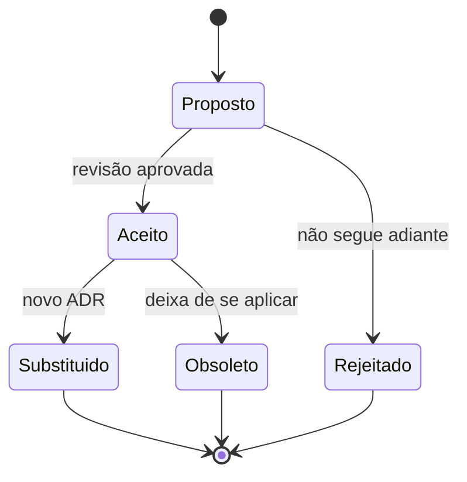

# 09 — Decisões arquiteturais (ADRs)

| Campo | Valor |
|---|---|
| Status | Registro retroativo das decisões observadas no código |
| Público | Engenharia, arquitetura e revisores |
| Última revisão | 2026-10-27 |
| Formato | [MADR 4.0](https://adr.github.io/madr/) adaptado |
| Fonte de verdade | Código e configurações atuais |

> **Sobre o momento destes registros.** O repositório não possui histórico de ADRs. Os documentos abaixo foram escritos em 2026-10-26 para registrar decisões que já estão **materializadas no código**. Não afirmam quando a decisão foi tomada, apenas que ela vigora. Onde a implementação diverge da intenção aparente, o ADR registra a divergência em vez de descrever o ideal.

---

## 1. Por que registrar decisões

Um ADR responde três perguntas que o código sozinho não responde:

1. **Por que** esta escolha foi feita?
2. **Quais alternativas** foram descartadas?
3. **Quais consequências** aceitamos, incluindo as ruins?

Sem esse registro, cada refatoração futura rediscute decisões já tomadas ou, pior, desfaz escolhas estruturais sem perceber o impacto.

---

## 2. Índice

| ID | Decisão | Status | Impacto |
|---|---|---|---|
| [0001](0001-microsservicos-e-api-gateway.md) | Microsserviços com API Gateway central | Aceito | Estrutural |
| [0002](0002-database-per-service-e-liquibase.md) | Database-per-service com Liquibase | Aceito | Estrutural |
| [0003](0003-jwt-hs256-no-gateway-e-identity.md) | JWT HS256 emitido no identity e validado no gateway | Aceito | Segurança |
| [0004](0004-frontend-nextjs-unico.md) | Frontend único em Next.js para os quatro perfis | Aceito | Produto |
| [0005](0005-documentacao-como-codigo.md) | Documentação como código, em português | Aceito | Processo |
| [0006](0006-postgresql-como-fonte-de-verdade.md) | PostgreSQL como banco de todos os ambientes | Aceito | Dados |
| [0007](0007-pagamento-simulado-no-order-service.md) | Pagamento simulado dentro do order-service | Aceito (provisório) | Produto |
| [0008](0008-eventos-de-pedido-com-sse-e-kafka.md) | Eventos de pedido por SSE e Kafka | Aceito | Integração |
| [0009](0009-agenda-de-producao-por-esforco.md) | Agenda de produção por esforço e agenda pública da cozinha | Aceito | Produto, dados e integração |
| [0010](0010-cadastro-de-usuarios-por-perfil-e-tenant.md) | Cadastro de usuários por perfil e vínculo com loja | Aceito | Identidade e autorização |
| [0011](0011-polyrepo-com-submodulos.md) | Polyrepo com submódulos Git | Aceito | Estrutural |
| [0012](0012-kit-desenvolvimento-em-containers.md) | Kit de desenvolvimento com Compose em dois modos | Substituído por 0013 | Operacional |
| [0013](0013-compose-unico-com-tudo.md) | Compose único com infraestrutura, backend e frontend | Aceito | Operacional |
| [0014](0014-remocao-do-agregador-maven.md) | Remoção do agregador Maven em `backend/` | Aceito | Estrutural |

### 2.1 Decisões que faltam registrar

Estas escolhas existem no código mas ainda não têm ADR. Criar quando forem estabilizadas ou questionadas:

| Tema | Situação atual |
|---|---|
| Parent POM e BOM compartilhados entre serviços | Cada serviço declara `spring-boot-starter-parent` 4.1.1 e versões próprias; bump exige cinco PRs |
| Pipeline de CI por repositório | Não existe; decisão de ferramenta pendente |
| Comunicação síncrona via `RestClient` entre serviços | `OrderDataSeeder` e `TenantLookup` chamam o tenant-service; `CatalogLookup` chama o catálogo |
| Autenticação por SMS para reset administrativo | Twilio opcional |
| Estrutura de tema white-label por slug | `ThemeDto` e cores no tenant |
| Uso de `localStorage` para sessão no web | Risco de XSS registrado em `06-seguranca.md` |
| Redis provisionado sem uso | Decisão de infraestrutura pendente |

---

## 3. Ciclo de vida



| Status | Significado |
|---|---|
| **Proposto** | Em discussão; não vincula implementação |
| **Aceito** | Vigente; o código deve segui-lo |
| **Substituído por NNNN** | Não vale mais; o novo ADR prevalece |
| **Obsoleto** | Deixou de se aplicar sem substituição |
| **Rejeitado** | Avaliado e descartado; mantido para memória |

Regras:

- ADRs aceitos são **imutáveis**. Corrija com um novo ADR, não editando o antigo.
- Um ADR descreve uma decisão, não um tutorial. Detalhes operacionais ficam nos documentos numerados.
- Toda mudança estrutural deve citar o ADR no PR.

---

## 4. Como criar um ADR

```powershell
Copy-Item docs\tecnica\_templates\adr.md docs\tecnica\09-decisoes\0011-meu-tema.md
```

1. Use o próximo número livre.
2. Nome do arquivo em `kebab-case`, começando pelo número.
3. Preencha todas as seções; escreva “Não aplicável” em vez de deixar vazio.
4. Liste pelo menos duas alternativas reais.
5. Registre as consequências negativas — é a parte mais útil.
6. Adicione a linha no índice acima.
7. Abra o PR.

---

## 5. Convenções

| Item | Regra |
|---|---|
| Idioma | Português (pt-BR) |
| Título | Frase nominal objetiva |
| Arquivo | `NNNN-titulo-em-kebab-case.md` |
| Numeração | Sequencial, sem reutilizar |
| Links | Relativos para documentos internos |
| Código | Blocos com linguagem declarada |
| Tamanho | 1 a 3 páginas |

---

## 6. Referências

| Tema | Fonte |
|---|---|
| Formato | [MADR — Markdown Any Decision Records](https://adr.github.io/madr/) |
| Prática | [Michael Nygard — Documenting Architecture Decisions](https://cognitect.com/blog/2011/11/15/documenting-architecture-decisions) |
| Catálogo | [ADR GitHub Organization](https://adr.github.io/) |
| Decisões de arquitetura | [ISO/IEC/IEEE 42010:2022](https://www.iso.org/standard/74393.html) |
